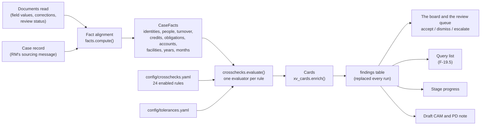

# Cross-verification: how every check works

| | |
|---|---|
| Feature | Stage 4 of the case workspace, the **Cross-checks** tab (`/appraisals/$caseId/cross-verification`) |
| Requirements | FRD F-18 (fact alignment) and F-19 (cross-checks) |
| Test plan rows | TC-20 Identity consistency, TC-21 Turnover, TC-22 Bank accounts, TC-23 Existing obligations (FRD TC-22 to TC-25); criteria C4 and C5 |
| Code | [engine/facts.py](../engine/facts.py) (alignment), [engine/crosschecks.py](../engine/crosschecks.py) (the checks), [engine/xv_cards](../engine/xv_cards/) (the cards), [engine/xv.py](../engine/xv.py) (the board and its decisions) |
| Configuration | [config/crosschecks.yaml](../config/crosschecks.yaml) (rules), [config/alignment.yaml](../config/alignment.yaml) (alignment conventions), [config/tolerances.yaml](../config/tolerances.yaml) (tolerances) |
| Related | [cross-verification-plan.md](cross-verification-plan.md) (the plan), [cross-verification-changes.md](cross-verification-changes.md) (the change register) |
| As at | 11 October 2026 |

This document explains the logic end to end: how extracted fields become comparable facts, how each rule decides its outcome (24 run; 6 more are defined but switched off), how the board shows the results, and how the four test-plan rows are met. Code is quoted from the repository; `# ...` marks lines left out of a quotation. The worked examples are real engine output, produced by building each case with the test helpers in [tests/triangulation.py](../tests/triangulation.py).

---

## Contents

1. [The idea in one page](#1-the-idea-in-one-page)
2. [When the checks run](#2-when-the-checks-run)
3. [Rules are configuration](#3-rules-are-configuration)
4. [Tolerances](#4-tolerances)
5. [Fact alignment (F-18)](#5-fact-alignment-f-18)
6. [Outcomes and the shared machinery](#6-outcomes-and-the-shared-machinery)
7. [After a run: the board, decisions, queries and the stage](#7-after-a-run-the-board-decisions-queries-and-the-stage)
8. [The four test cases](#8-the-four-test-cases)
9. [TC-20 Identity consistency](#9-tc-20-identity-consistency)
10. [TC-21 Turnover](#10-tc-21-turnover)
11. [TC-22 Bank accounts](#11-tc-22-bank-accounts)
12. [TC-23 Existing obligations](#12-tc-23-existing-obligations)
13. [Switched off: authority and the statements](#13-switched-off-authority-and-the-statements)
14. [Rule catalogue](#14-rule-catalogue)
15. [Known limits](#15-known-limits)
16. [Running the tests](#16-running-the-tests)

---

## 1. The idea in one page

A credit analyst cross-checks a file by holding the same fact from different documents side by side: the PAN on the PAN card against the PAN in the income tax return, the audited turnover against GST returns and bank credits, the facilities the borrower declared against the sanction letters, the bureau and the instalments in the bank statements. Cross-verification does the same, automatically, for every case.

It works in two layers:

1. **Fact alignment** ([engine/facts.py](../engine/facts.py), F-18). The values read from each document are made comparable: names normalised, periods brought to the same financial year or month, bank credits cleansed of transfers and loan disbursals, loan instalments inferred from recurring debits, and the set of bank accounts collected from every document. Every fact keeps the page it came from.
2. **The checks** ([engine/crosschecks.py](../engine/crosschecks.py), F-19). Each rule in [config/crosschecks.yaml](../config/crosschecks.yaml) compares one aligned fact across its sources and gives one outcome: **pass**, **fail**, **incomplete** (with what is missing named) or **not applicable**.

A failure is a **finding**. It carries both sides' values, each with its page, marks the side that differs, and often has a line-by-line table (months, people, years, lenders). A failure:

- is a discrepancy on the board, where a person accepts it as valid, dismisses it as not valid or escalates it to the Credit Manager, always with a comment (C5);
- adds a plain request to the pre-login query list, when the rule has one (F-19.5);
- appears in the draft CAM's summary and becomes a question in the PD note.



The four test-plan rows are the board's four areas; the income-tax rules are shown under Turnover, and the board-resolution and statement rules are switched off (section 13):

| Area | Rules | Test plan row |
|---|---|---|
| Identity consistency | ID-01 to ID-09 | **TC-20** Identity consistency |
| Turnover | TO-01 to TO-05, TX-01 to TX-05 | **TC-21** Turnover |
| Bank accounts | BA-01, BA-02 | **TC-22** Bank accounts |
| Existing obligations | OB-01 to OB-03 | **TC-23** Existing obligations |
| Borrowing authority | BR-01 to BR-04 | Switched off |
| Financial statements | FS-01, FS-02 | Switched off |

---

## 2. When the checks run

The checks run every time a case's derived state is refreshed: after each document is read, after a person confirms or corrects a value, after a re-read, and for every case when a configuration is published (`creditiq config publish` re-runs them all; `--no-rerun` skips that). The entry point is `refresh_case` in [engine/pipeline.py](../engine/pipeline.py):

```python
def refresh_case(conn: sqlite3.Connection, root: Path, case_id: str, *, running_job: str | None = None) -> None:
    from . import cases, crosschecks, parties, queries

    parties.refresh(conn, root, case_id)
    case = cases.get_case(conn, case_id)
    if case is not None:
        try:
            crosschecks.run(conn, root, case)
        except reader.NoPublishedConfig:
            # A configuration published before the cross-check sections
            # existed: the checks wait for the next publish.
            pass
    queries.refresh(conn, root, case_id)
    _update_stage(conn, root, case_id, running_job)
```

`crosschecks.run` aligns the facts, evaluates every rule and **replaces** the case's findings. A failure raises a review item. An open item whose finding no longer fails (because a document arrived or a value was corrected) is withdrawn. Decided items stay, as the record of the decision.

```python
def run(conn: sqlite3.Connection, root: Path, case: CaseDetail) -> list[Finding]:
    found = evaluate(root, case, facts_module.compute(conn, root, case))
    failing = {f"finding:{f.id}" for f in found if f.outcome == "fail"}
    with transaction(conn):
        conn.execute("DELETE FROM findings WHERE case_id = ?", (case.id,))
        for f in found:
            conn.execute("""INSERT INTO findings (...) VALUES (...)""", (...))
            if f.outcome == "fail":
                raise_item(conn, case_id=case.id, kind="finding", ref=f"finding:{f.id}",
                           summary=f"{f.rule_id} {f.title}: {f.explanation}",
                           detail={"finding_id": f.id, "rule_id": f.rule_id})
        for row in conn.execute(
            "SELECT id, ref FROM review_items WHERE case_id = ? AND kind = 'finding' AND status = 'open'", (case.id,)
        ).fetchall():
            if row["ref"] not in failing:
                conn.execute("DELETE FROM review_items WHERE id = ?", (row["id"],))
    return found
```

Finding ids are stable (`stable_id("FND", case, rule, scope)`), so the same check on the same case keeps its id across runs and a decision stays attached to it.

---

## 3. Rules are configuration

Every rule is a YAML entry (F-19.1). Nothing about a rule's sources, severity, tolerance or wording is in the code. TO-02 as an example:

```yaml
  - id: TO-02
    title: GST outward supplies against cleansed bank credits
    area: turnover
    variable: turnover_gst_vs_bank
    sources: [gstr_3b, bank_statement]
    comparison: tolerance
    tolerance: turnover_variance
    severity: moderate
    blocking: false
    explanation: "{period}: {left_label} {left} against {right_label} {right}, a variance of {variance} (tolerance {tolerance})."
    query: "Please explain the difference between GST outward supplies ({left}) and business credits in the bank statements ({right}) for {period}."
    pd_question: "{explanation} Are sales received in accounts not shown to us, or in cash?"
```

| Field | Meaning |
|---|---|
| `id`, `title`, `area` | How the check is named (`title` says what it compares) and the board area it is shown under |
| `finding_title` | The finding in plain English when the rule fails: the title of its card on the board |
| `policy_ref` | The credit policy clause the rule enforces, shown on its card and the banner (optional; none until RBL supplies them) |
| `enabled` | `false` switches the rule off: it stays in configuration and is still validated, but is not run (optional; default true) |
| `variable` | The aligned fact it compares; picks the evaluator in code |
| `sources` | The document types that supply the fact. `application_message` is the case record (the RM's sourcing message) |
| `comparison` | exact, tolerance, set_equal, set_contains, presence, bound or order |
| `tolerance` | A key in [config/tolerances.yaml](../config/tolerances.yaml) |
| `severity`, `blocking` | serious, moderate or mild; whether a failure blocks submission until a person accepts or dismisses it (it is also flagged on the Completeness summary) |
| `explanation` | The finding's sentence on failure. Placeholders: `{left}`, `{right}`, `{left_label}`, `{right_label}`, `{period}`, `{variance}`, `{tolerance}`, `{items}`, `{lenders}`, `{accounts}` |
| `query` | The request added to the customer's query list on failure (optional) |
| `pd_question` | What to ask the promoter in the personal discussion (optional) |

The `variable` selects one evaluator function; one function can serve several rules:

```python
EVALUATORS: dict[str, Callable[[Context, CrossCheckRule], list[Finding]]] = {
    "entity_pan": _identity,
    "gstin": _identity,
    "legal_name": _identity,
    "cin": _identity,
    "promoter_set": _promoter_set,
    # ...
    **{v: _turnover for v in TURNOVER_PAIRS},
    "turnover_gst_vs_bank_window": _turnover_window,
    # ...
    "declared_accounts_with_statements": _declared_accounts,
    "evidenced_accounts_declared": _evidenced_accounts,
    "facilities_reconcile": _facilities_reconcile,
    "emis_to_declared_lenders": _emis_declared,
    "borrowings_serviced": _borrowings_serviced,
}


def evaluate(root: Path, case: CaseDetail, facts: CaseFacts) -> list[Finding]:
    ctx = Context(root, case, facts)
    out: list[Finding] = []
    for rule in ctx.rules:
        evaluator = EVALUATORS.get(rule.variable)
        if evaluator is not None:
            out.extend(evaluator(ctx, rule))
    return out
```

Rules are read from the **published** configuration version (never from the YAML at run time), and each finding records the version it was produced under (`config_version`). Changing one tolerance and re-running changes exactly the findings that use it (F-19.6, tested by `test_changing_one_tolerance_changes_exactly_its_findings`).

---

## 4. Tolerances

All values are provisional until RBL supplies its working tolerances.

| Key | Value | Used by |
|---|---|---|
| `turnover_variance` | 10% | TO-01, TO-02, TO-03, TO-05, TX-03, TX-04, TX-05 |
| `declared_turnover_variance` | 20% | TO-04 |
| `name_match` | 0.85 | Every name comparison: legal names, people, lenders, banks |
| `emi_amount_match` | 5% | Obligation inference: debits this close to the typical amount are one instalment |
| `emi_min_occurrences` | 3 | Months of debits needed to infer an instalment |
| `turnover_window_min_months` | 3 | TO-05: months GST and bank statements must share |
| `itr_due_days` | 214 | TX-01: days after a year end before its income tax return is due |
| `profit_variance` | 10% | TX-02 |
| `comparatives_variance` | 1% | FS-01 (switched off) |
| `facility_amount_match` | 5% | OB-01: sanctioned amounts of one facility across sources |
| `balance_variance` | 1% | FS-02 (switched off) |

A variance is always measured against the larger of the two values, so it is symmetric:

```python
def _variance(a: float, b: float) -> float:
    top = max(abs(a), abs(b))
    return abs(a - b) / top * 100 if top else 0.0
```

---

## 5. Fact alignment (F-18)

`facts.compute` reads the case's documents once and builds every fact the rules use:

```python
def compute(conn: sqlite3.Connection, root: Path, case: CaseDetail) -> CaseFacts:
    # ...
    txns, coverage = _transactions(b)
    accounts, declared = _accounts(b, txns)
    credits, by_month = _cleanse(b, txns, accounts)
    years = _financial_years(b)
    return CaseFacts(
        case_id=case.id,
        identities=_identities(b),
        persons=_persons(b),
        turnover=_turnover(b, by_month, coverage),
        credits=credits,
        obligations=_obligations(b, txns),
        accounts=accounts,
        facilities=_facilities(b),
        declaration_received=declared,
        declaration=_declaration(b),
        declared_banking=b.message_value("existing_banking"),
        requested_amount=_requested(b),
        incorporation=_incorporation(b),
        authority=_authority(b),
        tax_years=_tax_years(b),
        financial_years=years,
        months=_months(b, by_month, coverage),
        balances=_balances(b, txns, years),
        types_on_file=sorted({t for d in b.docs for t in d.types}),
    )
```

The facts are also served at `GET /api/cases/{id}/facts`, so everything a check compared can be inspected (F-18 acceptance).

### 5.1 Effective values, manual entries and values under review

Only documents that have been classified (`accepted`, `in_review`, `extracted`, `classified`) are read. For each field:

- a person's correction wins over the value read (the **effective value**);
- a value typed or corrected by a person is flagged `manual`, and any finding that relies on it says so (F-19.4);
- a value still waiting for review is flagged `pending`, and a check that would rely on it waits (section 6.2).

```python
def _effective(row: sqlite3.Row) -> object:
    if row["status"] == "corrected" and row["corrected_value"] is not None:
        return json.loads(row["corrected_value"])
    return json.loads(row["value"]) if row["value"] is not None else None

# in load_documents():
            fields[fv["field"]] = Value(
                field_id=fv["id"],
                value=_effective(fv),
                evidence=json.loads(fv["evidence"]) if fv["evidence"] else None,
                manual=fv["method"] == "manual" or fv["status"] == "corrected",
                pending=fv["status"] == "in_review",
            )
```

Every fact keeps its `field_ids` and `evidence` (document and page), so evidence survives to the finding (F-18.6).

### 5.2 Identities

PAN, GSTIN, CIN and legal name are collected per document. Two rules matter:

- A director's KYC carries a **person's** PAN and name, so it is never read as the entity's.
- Characters 3 to 12 of a GSTIN are the holder's PAN, so every GSTIN is also a statement of the entity's PAN (that is how a PAN card and a GST return are compared even when the return prints no PAN).

```python
def _identities(b: Build) -> IdentityFacts:
    facts = IdentityFacts()
    for d in b.docs:
        pan = d.get(*PAN_FIELDS) if not set(d.types) & PERSON_DOCS else None
        if pan:
            facts.entity_pan.append(_fv(d, pan, _ident(pan.value)))
        gstin = d.get(*GSTIN_FIELDS)
        if gstin:
            number = _ident(gstin.value)
            facts.gstin.append(_fv(d, gstin, number))
            # Characters 3 to 12 of a GSTIN are the holder's PAN (ID-01).
            if len(number) == 15 and not set(d.types) & PERSON_DOCS:
                derived = _fv(d, gstin, number[2:12])
                derived.label = f"{d.label} (PAN within the GSTIN)"
                facts.entity_pan.append(derived)
        # ... CIN, and the legal name from legal_name, company_name, taxpayer_name,
        #     account_holder_name or borrower_name
    for key, target in (("pan", facts.entity_pan), ("gstin", facts.gstin), ("cin", facts.cin)):
        v = b.message_value(key)
        if v:
            v.value = str(v.value).strip().upper()
            target.append(v)
    return facts
```

The identifiers the RM confirmed on the case header (from the sourcing message) are a source too.

### 5.3 People

The people each source names, each with the DIN, PAN and designation printed there:

- **memorandum and articles** (subscribers and directors), **bureau report** (related parties) and other party lists, as configured per document type;
- **KYC received**: one set built from every director KYC on file;
- **sourcing message**: the promoters the RM confirmed (`promoters` header field, separated by `;`).

### 5.4 Financial years and months

Annual, monthly and transaction figures are brought to the same window (F-18.1). The financial year starts in April (`financial_year_start_month: 4`):

```python
def fy_of(year: int, month: int, start: int) -> int:
    """The calendar year in which the financial year containing (year, month) ends."""
    return year + 1 if month >= start and start != 1 else year
```

So May 2025 belongs to the year ending in 2026, named "FY 2025-26". Coverage gaps are recorded: a GST figure for a year records how many of its 12 return periods are on file and which are missing. A month counts as covered by the bank only when **every** account's statements cover it, because a month missing from one account would understate the credits.

### 5.5 Bank-credit cleansing

Before bank credits count as business inflow, credits that are not sales are removed by configured rules (F-18.2), applied in order, first match wins:

| Rule | Removed when |
|---|---|
| `own_account_transfer` | The narration carries the last digits of another account in the borrower's account set, or says "self transfer", "own account" or "sweep" together with the borrower's name |
| `loan_disbursal` | "loan disb", "disbursal", "disbursement", "ln disb", "tl disb", "loan a/c", "loan account" |
| `reversal` | "reversal", "reversed", "refund", "rev " |
| `returned_cheque` | "chq ret", "cheque return", "returned", "rtn", "bounce", "unpaid", "insufficient funds" |

Every exclusion is kept with its transaction, so the analyst can see what was removed and why:

```python
        rule = None
        for ex in b.align.bank_credit_exclusions:
            cue = _phrase(t.narration, ex.narration_any)
            if ex.own_account:
                digits = {_last4(m) for m in re.findall(r"\d{4,}", t.narration)}
                names_borrower = borrower and borrower.split()[0] in normalise_name(t.narration)
                if (digits & own_last4 - {t.account.split("·")[-1]}) or (cue and names_borrower):
                    rule = ex
                    break
            elif cue:
                rule = ex
                break
        if rule:
            acct.excluded += t.credit
            acct.exclusions.append(Exclusion(rule=rule.id, label=rule.label, ...))
            continue
        acct.net += t.credit
```

Narration cues match whole words or phrases, case-insensitively (`_phrase`), so "rev " does not match "revenue".

### 5.6 Obligations inferred from bank debits

A recurring debit to a lender is an inferred loan instalment (F-18.4) when:

1. the narration has an instalment cue: "nach", "ecs", "emi", "ach dr", "ach-dr", "si-", "standing instruction" or "loan repay";
2. the same counterparty is debited from the same account in at least 3 months (`emi_min_occurrences`);
3. at least 3 of the amounts are within 5% of the typical (median) amount (`emi_amount_match`).

```python
def _obligations(b: Build, txns: list[Txn]) -> list[Obligation]:
    candidates: dict[tuple[str, str], list[Txn]] = defaultdict(list)
    for t in txns:
        if not t.debit or not _phrase(t.narration, b.align.obligation_narration_any):
            continue
        party = _counterparty(t.narration, b.align.obligation_narration_any)
        if not party:
            continue
        key = next((k for k in candidates if k[1] == t.account and same_entity(party, k[0], b.noise, b.name_threshold)),
                   (party, t.account))
        candidates[key].append(t)
    out: list[Obligation] = []
    for (party, account), debits in candidates.items():
        months = sorted({(t.date.year, t.date.month) for t in debits if t.date})
        amounts = sorted(t.debit for t in debits)
        typical = amounts[len(amounts) // 2]
        steady = [a for a in amounts if abs(a - typical) <= typical * b.emi_tolerance_pct / 100]
        if len(months) < b.emi_min or len(steady) < b.emi_min:
            continue
        # ... Obligation(lender=party, account=account, months=..., typical_amount=typical, debits=len(debits))
```

The lender's name is what is left of the narration once cues, references and digits are removed:

```python
def _counterparty(narration: str, cues: list[str]) -> str | None:
    """The name in an instalment narration, without cues, references and digits:
    "NACH DR LOTUSCREST FIN 000123 EMI" -> "LOTUSCREST FIN"."""
```

### 5.7 The account set

Every bank account evidenced anywhere is collected (F-18.5), keyed by bank and last four digits:

| Where it is seen | Marks it |
|---|---|
| A bank statement | `has_statement` |
| The bank-accounts table of the declaration of existing facilities | `declared` |
| The RM's "existing banking" header field, e.g. "a/c 90100005678" | `declared` |
| A transfer narration in a statement ("NEFT TRANSFER TO A/C 778899001122") for an account not otherwise known | seen in transfers only |

```python
    for t in txns:
        for m in re.finditer(r"(?:a/?c|acct|account|x{2,})[^\d]{0,6}(\d{4,})", t.narration, re.I):
            last4 = _last4(m[1])
            if last4 and last4 not in own and _phrase(t.narration, ["transfer", "trf", "neft", "rtgs", "imps", "self"]):
                add("", last4, f"Transfer in {t.account}", t.evidence)
```

The same account seen in two places is merged when the last four digits match and the bank names are the same entity.

### 5.8 Existing facilities

Each facility as each source records it: the rows of the declaration's facilities table, each sanction letter (lender, and each facility row with sanctioned amount and EMI), and the bureau report's credit facilities (with outstanding and overdue). The declaration itself is also kept as a fact, including a declaration of **nil** facilities ("None declared"), which is a statement too.

### 5.9 Name matching

Names are compared after normalisation, never as raw strings (F-18.3):

```python
def normalise_name(name: str | None) -> str:
    """Lower case, honorifics and punctuation removed, company suffixes in
    one form: "M/s. Kestrel Fabricators Private Limited" -> "kestrel fabricators pvt ltd"."""

def similarity(a: str | None, b: str | None) -> float:
    """0 to 1: the better of the character ratio and the ratio with the
    words sorted (so "Velankar Tarun" matches "Tarun Velankar")."""
```

Two names are the same when their similarity is at least `name_match` (0.85). Lender and firm names first lose their noise words ("bank", "ltd", "limited", "pvt", "private", "co", "company", "finance", "financial", "services", "nbfc", "the"), so "Lotuscrest Bank Ltd" and "LOTUSCREST BANK LIMITED" are one lender:

```python
def resolve_name(name: str, noise: list[str]) -> str:
    words = [w for w in normalise_name(name).split() if w not in noise]
    return " ".join(words) or normalise_name(name)


def same_entity(a: str, b: str, noise: list[str], threshold: float) -> bool:
    ra, rb = resolve_name(a, noise), resolve_name(b, noise)
    return ra == rb or similarity(ra, rb) >= threshold


def same_lender(a: str, b: str, noise: list[str], threshold: float) -> bool:
    """One lender under two printings ("Tidewater Finance Limited", "TIDEWATER FIN"): the same
    resolved name, or the same leading significant word."""
    if same_entity(a, b, noise, threshold):
        return True
    ra, rb = resolve_name(a, noise).split(), resolve_name(b, noise).split()
    return bool(ra and rb) and ra[0] == rb[0] and len(ra[0]) >= 4
```

The libraries are the standard library's `difflib` only (no Levenshtein package, for licence reasons).

---

## 6. Outcomes and the shared machinery

### 6.1 The four outcomes

| Outcome | When |
|---|---|
| **pass** | The sources agree (within tolerance, where the rule has one) |
| **fail** | They do not. The finding carries both sides, the side that differs, the tolerance and the explanation |
| **incomplete** | The check cannot be completed: a source the case's checklist expects is not on file (named in `missing`), a period is not fully covered (the missing months named), or a value the check needs is still waiting for review |
| **not applicable** | There is nothing to compare and nothing is expected: for example no accounts were declared, or the case has only one source of the fact and the checklist expects no other |

A failure is never inferred from silence: a check short of sources is incomplete or not applicable, never a pass and never a fail.

### 6.2 Building a finding, and the review gate

Every evaluator ends in `_finding`. Before it writes the outcome, it applies the review gate (F-17.2): if any side rests on a value still waiting for review, a pass or fail becomes **incomplete** until a person confirms or corrects that value.

```python
def _finding(ctx: Context, rule: CrossCheckRule, outcome: str, sides: list[FindingSide], scope: str = "", *,
             note: str = "", detail: FindingDetail | None = None, missing: list[str] | None = None,
             **fmt: str) -> Finding:
    waiting = list(dict.fromkeys(s.label for s in sides if s.awaiting_review))
    if waiting and outcome in ("pass", "fail"):
        # F-17.2: a value below its threshold is reviewed before a check relies on it.
        outcome = "incomplete"
        note = f"Waiting for review of {', '.join(waiting)}; confirm or correct the value to complete this check."
    values = _Fmt(fmt)
    values.setdefault("tolerance", ctx.tol_text(rule.tolerance) or "")
    explanation = rule.explanation.format_map(values) if outcome == "fail" else note
    title = f"{rule.title} · {scope}" if scope else rule.title
    return Finding(
        id=stable_id("FND", ctx.case.id, rule.id, scope),
        # ...
        outcome=outcome,
        severity=rule.severity,
        blocking=rule.blocking,
        explanation=explanation,
        sides=sides,
        detail=detail,
        missing=missing or [],
        tolerance=(ctx.tol_text(rule.tolerance)
                   if rule.comparison in ("tolerance", "bound") and outcome != "not_applicable" else None),
        config_version=ctx.version,
        query=rule.query.format_map(values) if outcome == "fail" and rule.query else None,
    )
```

A rule's `scope` splits it into one finding per period: TO-01 to TO-04 give one finding per financial year ("· FY 2025-26"), TO-05 one per window of months.

### 6.3 Missing documents are named

When a rule has fewer than two sources to compare, `_absent` decides between incomplete and not applicable. It asks the case's **checklist**: if the checklist expects one of the rule's source documents and it is not on file, the check is incomplete and names it; otherwise there is nothing to do.

```python
def _absent(ctx: Context, rule: CrossCheckRule, sides: list[FindingSide] | None = None, scope: str = "", *,
            note: str = "Fewer than two sources state this.") -> Finding:
    """Too little to compare: incomplete if an expected document is missing (named), else not applicable."""
    missing = ctx.missing(rule)
    if missing:
        return _finding(ctx, rule, "incomplete", sides or [], scope, note=f"{_join(missing)} not on file.",
                        missing=missing)
    return _finding(ctx, rule, "not_applicable", sides or [], scope, note=note)

# Context.missing:
    def missing(self, rule: CrossCheckRule) -> list[str]:
        """The rule's source documents the case's checklist expects and that are not on file."""
        return [self.type_names.get(s, s) for s in rule.sources
                if s != CASE_RECORD and s in self.expected and s not in self.on_file]
```

The board lists such a check in its area under "Could not be checked", saying what would complete it ("Please provide the director KYC …"), with a button that puts the request on the query list.

### 6.4 Sides

Each side of a finding is a `FindingSide`: a label (the documents), the value, up to a few evidence pages, whether it relies on a manual entry, whether it waits for review, whether it is the side that **differs**, and the field ids behind it. On the board each source becomes a column of the finding's card (section 7), whose headline value and extracted rows open their pages; "Compare the pages side by side" opens two documents' pages next to each other (F-16.2).

---

## 7. After a run: the board, decisions, queries and the stage

**The board (F-19).** The Cross-checks tab shows the latest run by area ([engine/xv.py](../engine/xv.py)). Four overview cards, one per area (Identity consistency, Turnover, Bank accounts, Existing obligations), give each area's open discrepancies by severity, whether one blocks submission, how many checks could not run or passed, its top finding, and up to three key-figure lines from its findings (for example the PANs that differ, the turnover figures being compared, the accounts or lenders concerned). Below them, one section per area holds its discrepancies ranked by credit impact, the checks that could not run with what would complete them, the passed checks, and the facts behind the checks. Everything on the board comes from the run: the screen counts, ranks and computes nothing itself.

Credit impact is severity first, then the size of the gap in rupees (a finding without an amount after those with one), then the configured order:

```python
def rank_key(rules: Iterable[CrossCheckRule]) -> Callable[[Finding], tuple]:
    order = {r.id: i for i, r in enumerate(rules)}
    return lambda f: (SEVERITY_ORDER.get(f.severity, 9), f.amount is None, -(f.amount or 0.0),
                      order.get(f.rule_id, 999), f.scope or "")
```

Each discrepancy has a reference, XV-<case number>-<sequence>, given the first time it fails and kept on every later run, whatever its outcome then; each run is numbered XR-<case number>-<run> and records how many rules ran across how many document types.

**Cards.** After a rule decides its outcome, the card builder for its family ([engine/xv_cards](../engine/xv_cards/): identity, numbers, accounts, obligations, authority) lays out what it compared: one column per source (2 to 4) with its provenance (declared, borrower-supplied or independent, from `config/document_types.yaml`), headline value, what it covers, the rows extracted behind it (GST returns by month with their filing dates; bank credits by month and account, with each excluded credit on its own line) and the page each came from; the gap on each leg, as a percentage of the larger amount against the configured tolerance, or for a check without amounts the difference in words; and, for a check that could not run, what would complete it (nothing while the financial year it needs has not ended: no document could complete it yet). Each card also gives a few key-figure lines for its area's overview card (for example the two PANs, or the two turnover figures and how far apart they are). The gaps use the rules' own variance, so a leg is breached exactly when the rule failed. A card never changes an outcome, and a builder that fails leaves the card with the plain sides rather than stopping the checks:

```python
def enrich(ctx: Context, rule: CrossCheckRule, finding: Finding) -> None:
    """Build the finding's card. Never touches the outcome, the explanation or the sides.
    # ...
    builder = BUILDERS.get(rule.variable)
    if builder is not None:
        try:
            builder(ctx, rule, finding)
        except Exception:
            if STRICT:
                raise
            # ... the card falls back to the finding's sides
```

**Decisions (C5).** Each failure opens a review item. A person accepts it (a valid finding; it stays on the query list), dismisses it (not valid) or escalates it to the Credit Manager. A comment is required for every decision, and each is recorded with the user and the time. Accept and dismiss close the review item (confirm and waive); an escalated discrepancy stays open, and keeps blocking, until a holder of `finding.escalation` (the Credit Manager) accepts or dismisses it, on the board or in the review queue, again with a comment. The escalation is kept with the discrepancy (its rule and scope, as its reference is), so it survives a run in which the check briefly could not run. The review queue, too, requires a comment for every decision on a discrepancy. The finding itself is never changed by a decision:

```python
    if body.decision == "escalate":
        # ...
            detail["escalation"] = {"by": user["id"], "at": at, "comment": comment}
            # ...
    else:
        # ...
            review.decide(conn, root, item.review_item_id,
                          ReviewDecisionRequest(decision="confirm" if body.decision == "accept" else "waive",
                                                reason=comment), user)
```

**Blocking.** While a blocking discrepancy is not accepted or dismissed, the board shows "Submission blocked" with a link to it, and "Continue to draft" is locked.

**Query list (F-19.5).** A failure whose rule has a `query` adds a clarification to the pre-login query list, with the finding's pages as evidence, unless a person has found the flag not valid ([engine/queries.py](../engine/queries.py)):

```python
    for f in conn.execute(
        "SELECT * FROM findings WHERE case_id = ? AND outcome = 'fail' AND query IS NOT NULL ORDER BY rule_id, id",
        (case_id,),
    ).fetchall():
        if f"finding:{f['id']}" in waived:
            continue
        sides = json.loads(f["sides"] or "[]")
        evidence = [e for s in sides for e in (s.get("evidence") or [])[:1]]
        add("clarifications", f["query"], "finding", f["rule_id"] + ":" + f["id"], evidence)
```

A check that could not run can also put what would complete it on the query list ("Please provide …, so that the check … can be completed."). The query always asks for what the check needs now: as documents arrive the request narrows, and it is resolved when the check completes or only waits for a review.

**Stage progress.** The cross-verification stage starts once a check has compared two sources, and is done when every failed check has a person's decision ([engine/progress.py](../engine/progress.py)):

```python
    outcomes = [r["outcome"] for r in conn.execute("SELECT outcome FROM findings WHERE case_id = ?", (case_id,))]
    applicable = [o for o in outcomes if o != "not_applicable"] if {"pass", "fail"} & set(outcomes) else []
    open_findings = _open_items(conn, case_id, ("finding",))
    cross = StageProgress(
        key="cross_verification",
        status="not_started",
        done=sum(1 for o in applicable if o == "pass"),
        total=len(applicable),
        attention=open_findings,
    )
    if applicable and docs.status != "not_started":
        if "in_progress" in (docs.status, extraction.status):
            cross.status = "in_progress"
        else:
            cross.status = "needs_attention" if open_findings else "done"
```

**Elsewhere.** Blocking findings are counted on the Completeness summary with a link to the Cross-checks tab. The draft CAM lists the failed findings in its summary (dismissed ones are left out), and the PD note asks each failed rule's `pd_question`, ranked by severity. A switched-off rule gives no finding, so it appears in none of these.

---

## 8. The four test cases

| Test plan | FRD | Condition | Expected | Rules | Pass rule |
|---|---|---|---|---|---|
| **TC-20** Identity consistency | TC-22 | Identifiers across GST, ITR, KYC, financials and bureau | Mismatches in PAN, GSTIN, names or the promoter set flagged with their sources | ID-01 PAN, ID-02 GSTIN, ID-03 legal name, ID-04 promoter set; also ID-05 to ID-09 | C4, C5 |
| **TC-21** Turnover | TC-23 | Financials, GST and bank credits for the same period | Turnover compared across sources; variances beyond tolerance flagged with values; incomplete coverage stated | TO-01 to TO-05 | C4, C5 |
| **TC-22** Bank accounts | TC-24 | Accounts declared, statements provided, and accounts evidenced in other documents | Accounts without statements and undeclared accounts identified | BA-01, BA-02 | C4, C5 |
| **TC-23** Existing obligations | TC-25 | Declared facilities, sanction letters, bureau report and bank statements | Obligations reconciled; EMIs to lenders not declared are identified | OB-01, OB-02; also OB-03 | C4, C5 |

C4 asks that at least 85% of the evidenced discrepancies in RBL's record are found; C5 that at least 85% of the solution's flags are accepted as valid. Both are measured once RBL's case set and records arrive (F-25, F-26).

---

## 9. TC-20 Identity consistency

> **Expected:** mismatches in PAN, GSTIN, names or the promoter set flagged with their sources.

| Rule | Compares | Sources | Comparison | Severity |
|---|---|---|---|---|
| ID-01 | Entity PAN | Company PAN, income tax return, GSTR-3B (the PAN inside the GSTIN), bureau report, declaration of existing facilities, case record | Exact | Serious, blocking |
| ID-02 | GSTIN | GSTR-3B, bureau report, declaration, case record | Exact | Serious, blocking |
| ID-03 | Legal name | Every identity-bearing document (11 types) | Normalised match (`name_match`) | Moderate |
| ID-04 | Promoter set | KYC received, sourcing message, bureau report | Set equality (`name_match`) | Serious, blocking |
| ID-05 | CIN | Certificate of incorporation, memorandum, bureau report, declaration, case record | Exact | Serious, blocking |
| ID-06 | Director identifiers | KYC, memorandum | DIN agrees; KYC PAN is an individual's | Moderate |
| ID-07 | CIN against incorporation particulars | Certificate of incorporation, the case | Year and class encoded in the CIN | Mild |
| ID-08 | Memorandum directors accounted for | Memorandum, KYC, sourcing message | Containment | Mild |
| ID-09 | Names of people in full | KYC, memorandum, bureau report | First, middle and last name, part by part | Mild |

### 9.1 One value across sources (ID-01, ID-02, ID-03, ID-05)

All four use `_identity`. It groups the values that are "the same" (identical for identifiers, a name match for ID-03). One group means the sources agree; more than one is a mismatch. When one group clearly has the most sources, the other groups are marked as the side that differs; when no group is the clear majority, every side is marked.

```python
def _identity(ctx: Context, rule: CrossCheckRule) -> list[Finding]:
    values = [v for v in getattr(ctx.facts.identities, rule.variable) if v.source in rule.sources or v.source == CASE_RECORD]
    if rule.variable == "legal_name":
        threshold = ctx.tol(rule.tolerance, 0.85)
        groups = _groups(values, lambda a, b: _same_name(str(a), str(b), threshold))
    else:
        groups = _groups(values, lambda a, b: str(a) == str(b))
    largest = max((len(g) for g in groups), default=0)
    clear_majority = sum(1 for g in groups if len(g) == largest) == 1
    sides = [
        _side(
            ", ".join(dict.fromkeys(v.label for v in g)),
            g[0].value,
            [e for v in g for e in v.evidence[:1]],
            any(v.relies_on_manual for v in g),
            awaiting=any(v.awaiting_review for v in g),
            differs=len(groups) > 1 and not (clear_majority and len(g) == largest),
            field_ids=[i for v in g for i in v.field_ids],
        )
        for g in groups
    ]
    if len({(v.source, v.label, str(v.value)) for v in values}) < 2:
        return [_absent(ctx, rule, sides)]
    if len(groups) == 1:
        return [_finding(ctx, rule, "pass", sides, note=f"Consistent across {len(values)} sources.")]
    items = " · ".join(f"{s.value} ({s.label})" for s in sides)
    return [_finding(ctx, rule, "fail", sides, items=items)]
```

Identifiers are compared exactly, after spaces are removed and letters upper-cased (`_ident`). Legal names use `_same_name`, which also accepts a bank's truncated account-holder name as a prefix of the full name:

```python
def _same_name(a: str, b: str, threshold: float) -> bool:
    """Name variants of one entity; a bank's truncated account name is a prefix of the full one."""
    if similarity(a, b) >= threshold:
        return True
    na, nb = sorted((normalise_name(a), normalise_name(b)), key=len)
    return len(na) >= 8 and len(na.split()) >= 2 and nb.startswith(na)
```

So "Kestrel Tools Pvt Ltd" and "Kestrel Tools Private Limited" agree (both normalise to "kestrel tools pvt ltd"), and "KESTREL TOOLS PVT" on a bank statement is the same name.

### 9.2 The promoter set (ID-04)

Every person any source names is collected once (by name match). Each person must appear in **every** source; the gaps are listed person by person, with a table of who is in which source:

```python
def _promoter_set(ctx: Context, rule: CrossCheckRule) -> list[Finding]:
    # In the rule's order of sources, so the result does not depend on the order documents arrived in.
    sets = sorted((p for p in ctx.facts.persons if p.source in rule.sources), key=lambda p: rule.sources.index(p.source))
    if len(sets) < 2:
        return [_absent(ctx, rule, [_people_side(p.label, p.entries) for p in sets],
                        note="Fewer than two sources name the promoters.")]
    people: list[str] = []
    for p in sets:
        for name in p.names:
            if not any(ctx.same_person(name, q) for q in people):
                people.append(name)
    gaps, rows, short = [], [], set()
    for person in people:
        named = [any(ctx.same_person(person, n) for n in p.names) for p in sets]
        absent = [p.label for p, ok in zip(sets, named) if not ok]
        short |= set(absent)
        if absent:
            gaps.append(f"{person} is not in {', '.join(absent)}")
        rows.append((person, [YES if ok else NO for ok in named], bool(absent)))
    # ... pass with the table, or fail with items="; ".join(gaps)
```

The board resolution's authorised signatories are deliberately **not** part of the promoter set: a signatory can be an employee. Whether they are directors is BR-02's question (switched off since 11 October 2026).

### 9.3 Supporting identity checks (ID-06 to ID-09)

- **ID-06 Director identifiers agree.** For each KYC, the DIN is compared with the memorandum's DIN for the same person, and the KYC's PAN must be an individual's (the fourth character of a PAN is `P` for a person) and must not be the company's PAN.
- **ID-07 CIN agrees with the incorporation particulars.** A CIN encodes listing (`L`/`U`), industry, state, the **year of incorporation** (characters 9 to 12) and the **company class** (characters 13 to 15: `PTC` private, `PLC` public, and so on). The year is compared with the certificate's date of incorporation, and the class with the case's constitution:

  ```python
      if inc and when:
          sides.append(_fact_side(inc, "Date of incorporation"))
          rows.append(("Year of incorporation", [number[8:12], str(when.year)], number[8:12] != str(when.year)))
      constitution = ctx.case.constitution
      if constitution in ctx.constitutions and constitution != "unknown":
          cls = number[12:15]
          # ...
          rows.append(("Company class", [f"{CIN_CLASSES.get(cls, cls)} ({cls})", label],
                       (constitution == "private_limited") != (cls == "PTC")))
  ```

- **ID-08 Directors in the memorandum are accounted for.** Each director the memorandum names must have a KYC or be named in the sourcing message; otherwise the customer is asked whether they are still a director.
- **ID-09 Names of people agree in full** (added 12 October 2026). ID-04, ID-06 and ID-08 match people by similarity (at least `name_match`), so "Tarun S. Velankar" and "Tarun Velankar" (about 93% alike) are one person and pass. ID-09 looks inside that match. It takes each person named in two or more of the director KYC, the memorandum and the bureau report (the sourcing message is left out, as RMs often shorten names). It splits each name into first name, middle names and last name, after removing honorifics (Mr, Shri, Dr and so on). Then it compares every document's form with the fullest form. A part can be the same, **missing** in one document, given **only as an initial** ("T. Velankar"), or **different** ("Barvey" against "Barve"). The order of the words is not a difference ("Velankar Tarun" is "Tarun Velankar"). People are grouped as the other checks group them; where similarity misses a short form, the same surname with the same first name or its initial also groups them. Any part not the same fails the check. It is mild and does not block, and ID-04, ID-06 and ID-08 give exactly what they gave before.

  ```python
  def compare_name_parts(a, b) -> dict[str, str | None]:      # engine/names.py
      pa, pb = name_parts(a), name_parts(b)
      words_a, words_b = sorted(_key(w) for w in pa.words()), sorted(_key(w) for w in pb.words())
      if words_a and words_a == words_b:                       # the order is not a difference
          return {"first": "same", "middle": "same" if pa.middle else None, "last": "same" if pa.last else None}
      # ... a surname written first is read as the surname
      return {"first": _word_status(pa.first, first_b), "middle": _middle_status(pa.middle, pb.middle),
              "last": _word_status(pa.last, last_b)}
  ```

  The finding's line-by-line table has one row per person and document: the name as written and, for each part, ✓, **Missing**, **Initial only** or **Different**. The part that differs is marked (`flagged_cells`), and a part neither name has is left blank. The card shows each document's people split into first, middle and last name. The overview line names the person and what differs ("middle name missing in KYC received and Memorandum and articles of association"). The query asks the customer to confirm each person's full name as on their PAN.

### 9.4 Worked example

A case whose bureau report shows another PAN and another state's GSTIN, whose audited statements carry another company's name, and where the RM named a promoter with no KYC:

```text
ID-01  FAIL  [serious, blocking]  Entity PAN consistent across documents
    The entity PAN differs between documents: AAACK1234F (Company PAN, Income tax return,
    GSTR-3B (PAN within the GSTIN), Commercial bureau report (PAN within the GSTIN)) ·
    AAACK9999Z (Commercial bureau report).
    side: Company PAN, Income tax return, GSTR-3B (PAN within the GSTIN), ... = AAACK1234F
    side: Commercial bureau report = AAACK9999Z   <- differs

ID-02  FAIL  [serious, blocking]  GSTIN consistent across documents
    The GSTIN differs between documents: 27AAACK1234F1Z0 (GSTR-3B) · 29AAACK1234F1Z5 (Commercial bureau report).

ID-03  FAIL  [moderate]  Legal name consistent across documents
    The legal name reads differently across documents: Kestrel Tools Pvt Ltd (Company PAN,
    Income tax return, GSTR-3B, Commercial bureau report) · Orchid Weaves Private Limited
    (Audited financial statements).

ID-04  FAIL  [serious, blocking]  Promoters match the KYC received
    The promoters named differ between sources: Ishita Barve is not in KYC received.
                      KYC received   Sourcing message   Commercial bureau report
    Tarun Velankar    ✓              ✓                  ✓
    Ishita Barve      —              ✓                  ✓        <- flagged
    Query: Please confirm the full list of directors, partners or the proprietor; Ishita Barve is not in KYC received.
```

Note the bureau report appears on both sides of ID-01: its own PAN field disagrees (AAACK9999Z), while the PAN inside its GSTIN agrees. Each statement of the PAN is held separately, so the screen shows exactly which printing differs.

### 9.5 Tests that prove TC-20

[tests/test_crosschecks.py](../tests/test_crosschecks.py), [tests/test_crosschecks_areas.py](../tests/test_crosschecks_areas.py), [tests/test_crosschecks_facilities.py](../tests/test_crosschecks_facilities.py):

| Test | Shows |
|---|---|
| `test_tc22_a_pan_mismatch_is_flagged_with_both_sources` | PAN mismatch, each side's page |
| `test_tc22_a_directors_pan_is_not_the_entitys` | A KYC's PAN is never read as the entity's |
| `test_tc22_two_gstins_across_returns_are_flagged` | GSTIN mismatch |
| `test_tc22_a_legal_name_mismatch_is_flagged_with_its_sources` | Name mismatch |
| `test_tc22_a_promoter_missing_from_one_source_is_flagged` | Promoter set, person by person |
| `test_tc22_the_board_resolutions_signatories_are_not_the_promoter_set` | No false flag from signatories |
| `test_the_pan_within_a_gstin_is_compared_with_the_entity_pan` | GSTIN-derived PAN |
| `test_a_banks_truncated_account_name_is_the_same_legal_name` | The prefix rule |
| `test_a_cin_mismatch_is_flagged_and_a_missing_source_is_named` | ID-05, and a missing document named |
| `test_director_identifiers_disagreeing_are_flagged_by_person` | ID-06 |
| `test_the_cin_is_held_against_the_incorporation_date_and_constitution` | ID-07 |
| `test_a_director_in_the_memorandum_without_kyc_is_asked_about` | ID-08 |
| [tests/test_crosschecks_names.py](../tests/test_crosschecks_names.py): `test_a_name_is_compared_part_by_part`, `test_a_middle_name_missing_in_one_document_is_a_partial_match`, `test_a_first_name_given_only_as_an_initial_is_found_where_similarity_misses_it`, `test_a_surname_written_differently_is_named_with_its_spelling` | ID-09, part by part |
| `test_the_bureau_is_a_source_of_the_entity_pan`, `..._gstin_is_compared_with_the_returns`, `test_a_director_the_bureau_names_without_kyc_is_flagged` | The bureau report as a source |

For example:

```python
def test_tc22_a_pan_mismatch_is_flagged_with_both_sources(client, analyst, published_data_root):
    case_id = _case(client, analyst, published_data_root)
    pan_doc = add_doc(published_data_root, case_id, "company_pan", {"pan": "AAACK1234F", "company_name": "Kestrel Tools Pvt Ltd"})
    itr = add_doc(published_data_root, case_id, "income_tax_return", {"pan": "AAACK9876Q", "taxpayer_name": "Kestrel Tools Pvt Ltd"})
    [f] = _findings(client, analyst, published_data_root, case_id)["ID-01"]
    assert f["outcome"] == "fail" and f["severity"] == "serious" and f["blocking"]
    values = {s["value"]: s for s in f["sides"]}
    assert values["AAACK1234F"]["evidence"][0]["document_id"] == pan_doc
    assert values["AAACK9876Q"]["evidence"][0]["document_id"] == itr
    assert "AAACK9876Q" in f["explanation"] and "AAACK1234F" in f["explanation"]
```

---

## 10. TC-21 Turnover

> **Expected:** turnover compared across sources; variances beyond tolerance flagged with values; incomplete coverage stated.

| Rule | Compares, per financial year | Tolerance | Severity |
|---|---|---|---|
| TO-01 | Audited turnover against GST outward supplies | 10% | Moderate |
| TO-02 | GST outward supplies against cleansed bank credits | 10% | Moderate |
| TO-03 | Audited turnover against cleansed bank credits | 10% | Moderate |
| TO-04 | Turnover the RM declared against evidenced turnover | 20% | Mild |
| TO-05 | GST against bank credits over the **months both cover**, in any year | 10% | Moderate |
| TX-01 | Each audited year has its income tax return, once due | 214 days | Mild |
| TX-02 | Profit before tax in the books against the tax return | 10% | Moderate |
| TX-03 | Turnover in the tax return against audited revenue | 10% | Moderate |
| TX-04 | Turnover in the tax return against GST outward supplies | 10% | Moderate |
| TX-05 | Turnover in the tax return against cleansed bank credits | 10% | Moderate |

The tax-return rules are in section 10.6.

### 10.1 The four turnover figures

For each financial year, `facts._turnover` builds up to four figures:

| Figure | How it is built |
|---|---|
| **Audited** (`financials`) | Revenue from operations, read from the printed statement row of the audited statements for that year |
| **GST** (`gst`) | Outward supplies summed over the year's GSTR-3B return periods on file: rows (a) taxable, (b) zero rated and (c) nil rated or exempt, taxable value. Records `months_covered` and `months_missing` |
| **Bank** (`bank`) | Cleansed credits (section 5.5) summed over the months **every** account's statements cover. Records `months_covered` and `months_missing` |
| **Declared** (`declared`) | The turnover the RM confirmed on the case, taken as the latest financial year ended before the case's appraisal date |

```python
    # GST: outward supplies per return period, from each GSTR-3B.
    gst = _gst_by_month(b)
    for fy in sorted({fy_of(y, m, start) for (y, m) in gst}):
        months = fy_months(fy, start)
        present = [m for m in months if m in gst]
        values = [gst[m] for m in present]
        years[fy].append(TurnoverFigure(
            source="gst", label="GST outward supplies", value=sum(v[0] for v in values),
            months_covered=len(present), months_missing=[month_label(m) for m in months if m not in gst],
            # ... evidence, field ids, manual and review flags
        ))

    # Bank: cleansed credits; a month counts as covered when every account's statements cover it.
    if coverage:
        covered = set.intersection(*coverage.values())
        # ... the same per-year sum over the covered months
```

### 10.2 TO-01 to TO-04: whole financial years

One function compares a pair of figures, year by year. Its rule decides which pair:

```python
TURNOVER_PAIRS = {
    "turnover_audited_vs_gst": ("financials", "gst"),
    "turnover_gst_vs_bank": ("gst", "bank"),
    "turnover_audited_vs_bank": ("financials", "bank"),
    "turnover_declared_vs_evidenced": ("declared", "financials"),
}
```

For each year where both figures exist:

1. If either covers fewer than 12 months, the year is **incomplete**, and the missing months are named ("GST outward supplies covers 8 of 12 months (Apr 2025, May 2025, Jun 2025… absent)"). Partial figures are never compared, because a partial year would always look low.
2. Otherwise the variance is measured against the larger figure, and the year passes within the tolerance or fails beyond it, with both values, the variance and the tolerance in the sentence.

```python
def _turnover(ctx: Context, rule: CrossCheckRule) -> list[Finding]:
    left_key, right_key = TURNOVER_PAIRS[rule.variable]
    years = []
    for y in ctx.facts.turnover:
        by = {f.source: f for f in y.figures}
        right = by.get(right_key)
        if rule.variable == "turnover_declared_vs_evidenced" and right is None:
            gst = by.get("gst")
            right = gst if gst and gst.months_covered == 12 else None
        years.append((y, by.get(left_key), right))
    if left_key == "declared" and not any(lf for _, lf, _ in years):
        # Nothing was declared: there is nothing to hold the evidence against.
        return [_finding(ctx, rule, "not_applicable", [], note="No turnover was declared in the sourcing message.")]
    # ... a year with only one figure: incomplete, naming the missing source
    tol = ctx.tol(rule.tolerance, 10)
    for y, lf, rf in both:
        gaps = [f"{f.label} covers {f.months_covered} of 12 months (... absent)"
                for f in (lf, rf) if f.months_covered is not None and f.months_covered < 12]
        if gaps:
            out.append(_finding(ctx, rule, "incomplete", [_figure_side(lf), _figure_side(rf)], y.fy,
                                note="; ".join(gaps) + "."))
            continue
        a, b = float(lf.value or 0), float(rf.value or 0)
        variance = abs(a - b) / max(a, b) * 100 if max(a, b) else 0.0
        failed = variance > tol
        # ... pass "Variance x% within 10%", or fail with period, left, right, labels and variance
```

TO-04 holds the RM's declared figure against the audited turnover, or against a full year of GST returns when no audited statements cover that year. It does not apply when the RM declared no turnover.

### 10.3 TO-05: the months both sources cover

A typical file holds the latest 12 months of returns and statements, for example September to August, which straddles two financial years. TO-01 and TO-02 then end incomplete for both years. TO-05 still compares GST and bank credits over exactly the months both cover:

```python
def _turnover_window(ctx: Context, rule: CrossCheckRule) -> list[Finding]:
    """TO-05: GST against cleansed bank credits over the months both cover, in any financial year."""
    months = ctx.facts.months
    gst = [m for m in months if m.gst is not None]
    bank = [m for m in months if m.bank is not None]
    if not gst or not bank:
        return [_absent(ctx, rule, note="Needs both GST returns and bank statements.")]
    both = [m for m in months if m.gst is not None and m.bank is not None]
    need = int(ctx.tol("turnover_window_min_months", 3))
    if len(both) < need:
        return [_finding(ctx, rule, "incomplete", [], note=(
            f"The GST returns (...) and the bank statements (...) share {len(both)} month(s); "
            f"at least {need} are needed to compare them."))]
    window = [_ym(m.month) for m in both]
    years = {facts_module.fy_of(y, mo, ctx.fy_start) for y, mo in window}
    whole_year = len(years) == 1 and window == facts_module.fy_months(years.pop(), ctx.fy_start)
    if whole_year and any(r.variable == "turnover_gst_vs_bank" for r in ctx.rules):
        # One whole financial year: TO-02 compares it.
        return [_finding(ctx, rule, "not_applicable", [], note="The months both cover are one financial year, compared above.")]
    tol = ctx.tol(rule.tolerance, 10)
    g_total = sum(m.gst or 0 for m in both)
    b_total = sum(m.bank or 0 for m in both)
    variance = _variance(g_total, b_total)
    # ... a month-by-month table, each month flagged when its own variance exceeds the tolerance
```

### 10.4 Worked example

Audited turnover INR 4.80 cr for FY 2025-26; GST returns for August to March only (INR 40 lakh a month); bank statements for the full year with INR 30 lakh of sales credits a month, plus a term-loan disbursal of INR 50 lakh; the RM declared INR 5 cr.

```text
TO-01  INCOMPLETE  Audited turnover against GST outward supplies · FY 2025-26
    GST outward supplies covers 8 of 12 months (Apr 2025, May 2025, Jun 2025… absent).

TO-02  INCOMPLETE  GST outward supplies against cleansed bank credits · FY 2025-26
    GST outward supplies covers 8 of 12 months (Apr 2025, May 2025, Jun 2025… absent).

TO-03  FAIL  [moderate]  Audited turnover against cleansed bank credits · FY 2025-26
    FY 2025-26: Audited financial statements INR 4.80 cr against Business credits in bank
    statements INR 3.60 cr, a variance of 25.0% (tolerance 10%).

TO-04  PASS  RM-declared turnover against evidenced turnover · FY 2025-26
    Variance 4.0% within 20%.

TO-05  FAIL  [moderate]  GST outward supplies against bank credits, months both cover · Aug 2025 to Mar 2026
    Aug 2025 to Mar 2026: GST outward supplies INR 3.20 cr against business credits INR 2.40 cr,
    a variance of 25.0% (tolerance 10%).
                GST outward supplies   Business credits   Difference
    Aug 2025    40,00,000              30,00,000          25.0%   <- flagged
    ...         (each month the same)
    Mar 2026    40,00,000              30,00,000          25.0%   <- flagged
    Query: Please explain the difference between GST outward supplies (INR 3.20 cr) and business
    credits in the bank statements (INR 2.40 cr) for Aug 2025 to Mar 2026.
```

The bank figure is INR 3.60 cr, not INR 4.10 cr: the INR 50 lakh "TL DISB" credit was removed as a loan disbursal before the comparison, and is listed among the exclusions.

### 10.5 Tests that prove TC-21

| Test | Shows |
|---|---|
| `test_tc23_gst_against_bank_beyond_tolerance_is_flagged_with_values` | A variance beyond tolerance, with both values, the variance and the tolerance |
| `test_tc23_within_tolerance_passes` | Within tolerance passes |
| `test_tc23_incomplete_coverage_is_stated` | Missing months named; TO-03 still compares the years both cover |
| `test_tc23_audited_turnover_is_read_from_the_printed_statement` | The audited figure is the printed row |
| `test_declared_turnover_check_does_not_apply_without_a_declaration` | TO-04 not applicable |
| `test_gst_and_bank_are_compared_over_the_months_both_cover`, `test_too_few_shared_months_leave_the_window_incomplete` | TO-05 |
| `test_turnover_is_aligned_by_financial_year`, `test_bank_credits_are_cleansed_with_every_exclusion_kept` ([tests/test_facts.py](../tests/test_facts.py)) | The alignment behind the comparison |
| [tests/test_crosschecks_tax_turnover.py](../tests/test_crosschecks_tax_turnover.py) | TX-03 to TX-05 against each source, pass and fail; a part year incomplete; a return without turnover, or a source not reaching its year, not applicable; a missing return asked for; each year on its own; the card; TX-01 and TX-02 under Turnover |

```python
def test_tc23_incomplete_coverage_is_stated(client, analyst, published_data_root):
    case_id = _case(client, analyst, published_data_root)
    _turnover(published_data_root, case_id, gst_months=PERIODS[4:], gst_each=4_000_000, bank_each=3_000_000, audited_revenue=48_000_000)
    found = _findings(client, analyst, published_data_root, case_id)
    [to1] = found["TO-01"]
    assert to1["outcome"] == "incomplete"
    assert "GST outward supplies covers 8 of 12 months (Apr 2025, May 2025, Jun 2025… absent)" in to1["explanation"]
    [to3] = found["TO-03"]
    assert to3["outcome"] == "fail"  # 4.8 cr audited against 3.6 cr banked, 25%
```

### 10.6 The income tax return: TX-01 to TX-05

- **TX-01 Each audited year has its income tax return.** For each audited year, a return must be on file once it is due: the year end plus 214 days (`itr_due_days`). A year whose return is not yet due shows "Not yet due (date)" and is not flagged.

  ```python
      for y in years:
          due = date.fromisoformat(y.fy_end) + timedelta(days=due_days)
          filed = y.fy in have
          if filed:
              state = YES
          elif due > ctx.as_of:
              state = f"Not yet due ({display_date(due)})"
          else:
              state = NO
              missing.append(y.fy)
  ```

- **TX-02 Profit in the income tax return agrees with the books.** For each year with both, the audited profit before tax against the return computation's profit as per the accounts, within 10% (`profit_variance`).

- **TX-03 to TX-05: the turnover in the return.** The return's computation is read for its turnover (`config/statements.yaml` `itr_lines`: revenue from operations, gross receipts, turnover or total sales), and it becomes a fifth turnover figure for the financial year the return covers (`itr`, "Turnover in the income tax return"). Each rule holds it against one other figure for that year, within 10% (`turnover_variance`): TX-03 audited revenue, TX-04 GST outward supplies, TX-05 cleansed bank credits. The comparison of a year is the one TO-01 to TO-04 use, so GST and bank figures need all 12 months, and a part year is incomplete with its missing months named.

  The returns set the years: a return is filed after its year ends, so the latest year's figures usually have no return to meet yet. A return that shows no turnover, or another source that does not reach the return's year, leaves nothing to compare (not applicable); a missing return is asked for only when the checklist expects one ([engine/crosschecks.py](../engine/crosschecks.py)):

  ```python
  def _itr_turnover(ctx: Context, rule: CrossCheckRule) -> list[Finding]:
      _, right_key = TURNOVER_PAIRS[rule.variable]
      filed = []
      for y in ctx.facts.turnover:
          by = {f.source: f for f in y.figures}
          if "itr" in by:
              filed.append((y, by["itr"], by.get(right_key)))
      if not filed:
          if ctx.facts.tax_years:
              return [_finding(ctx, rule, "not_applicable", [],
                               note="The income tax return on file does not show its turnover.")]
          # ... asked for only when the checklist expects a return
      compared = [(y, lf, rf) for y, lf, rf in filed if rf is not None]
      # ... none compared: the other source does not reach the returns' years
      tol = ctx.tol(rule.tolerance, 10)
      return [_compare_year(ctx, rule, y, lf, rf, tol) for y, lf, rf in compared]
  ```

  On the Kestrel test application, the FY 2025-26 return shows INR 11.90 cr: within 0.8% of the audited INR 11.80 cr and of GST's INR 12.00 cr, but 24.4% above the INR 9.00 cr of business credits, so TX-05 fails while TX-03 and TX-04 pass.

The income-tax rules were switched off on 11 October 2026 and back on on 12 October, shown under Turnover so the board keeps its four areas.

---

## 11. TC-22 Bank accounts

> **Expected:** accounts without statements and undeclared accounts identified.

| Rule | Checks | Severity |
|---|---|---|
| BA-01 | Every **declared** account has a statement on file | Moderate |
| BA-02 | Every account **on file** (a statement, or seen in a transfer) is declared | Moderate |

Both work on the account set (section 5.7). "Declared" means listed in the declaration of existing facilities or in the RM's "existing banking" note.

### 11.1 BA-01: declared accounts have statements

```python
def _declared_accounts(ctx: Context, rule: CrossCheckRule) -> list[Finding]:
    declared = [a for a in ctx.facts.accounts if a.declared]
    if not declared:
        note = ("The sourcing message names no account numbers." if ctx.facts.declared_banking
                else "No accounts were declared in the sourcing message.")
        return [_finding(ctx, rule, "not_applicable", [], note=note)]
    without = [a for a in declared if not a.has_statement]
    sides = [_declared_accounts_side(ctx, declared), _statements_side(ctx, differs=bool(without))]
    detail = _rows(["Statement on file"], [(a.label, [YES if a.has_statement else NO], not a.has_statement) for a in declared])
    if without:
        return [_finding(ctx, rule, "fail", sides, detail=detail, items=_join([a.label for a in without]))]
    return [_finding(ctx, rule, "pass", sides, detail=detail, note=f"All {len(declared)} declared account(s) have statements.")]
```

### 11.2 BA-02: accounts on file are declared

Two kinds of undeclared account are flagged:

- an account **seen only in transfers** (a statement's narration sends money to it), with no statement and not declared, always;
- an account **with a statement** that nobody declared, once the RM or a declaration has declared any account. (If nothing at all was declared, the statements on file are not called undeclared: there is no declaration to be missing from.)

```python
def _evidenced_accounts(ctx: Context, rule: CrossCheckRule) -> list[Finding]:
    accounts = ctx.facts.accounts
    if "bank_statement" not in ctx.on_file and not accounts:
        return [_absent(ctx, rule, note="No bank statements are on file.")]
    declared = [a for a in accounts if a.declared]
    in_transfers = [a for a in accounts if not a.has_statement and not a.declared]
    undeclared = [a for a in accounts if a.has_statement and not a.declared] if declared else []
    flagged = {a.label for a in in_transfers + undeclared}
    # ... sides: declared, statements on file, seen in transfers; a table of every account
    items = [f"{a.label} has a statement but was not declared" for a in undeclared]
    items += [f"{a.label} appears in transfers but has no statement and was not declared" for a in in_transfers]
    return [_finding(ctx, rule, "fail", sides, detail=detail, items="; ".join(items),
                     accounts=_join([a.label for a in undeclared + in_transfers]))]
```

### 11.3 Worked example

The RM declared two Lotuscrest accounts (·1234 and ·5678). Statements are on file for ·1234 and for an Ironleaf Bank account ·7777; the ·1234 statement shows a transfer to account ·1122.

```text
BA-01  FAIL  [moderate]  Declared accounts have statements
    No statement is on file for the declared account(s) Account ·5678.
                            Statement on file
    Lotuscrest Bank ·1234   ✓
    Account ·5678           —      <- flagged
    Query: Please provide 12 months' statements for Account ·5678.

BA-02  FAIL  [moderate]  Accounts on file are declared
    Ironleaf Bank ·7777 has a statement but was not declared; Account ·1122 appears in
    transfers but has no statement and was not declared.
                            Declared   Statement on file   Where it appears
    Lotuscrest Bank ·1234   ✓          ✓                   Bank statement; Sourcing message
    Ironleaf Bank ·7777     —          ✓                   Bank statement                     <- flagged
    Account ·5678           ✓          —                   Sourcing message
    Account ·1122           —          —                   Transfer in Lotuscrest Bank ·1234  <- flagged
    Query: Please confirm whose account each of these is and why it was not declared, and
    provide 12 months' statements where missing: Ironleaf Bank ·7777 and Account ·1122.
```

### 11.4 Tests that prove TC-22

| Test | Shows |
|---|---|
| `test_a_declared_account_without_a_statement_is_flagged` | BA-01 |
| `test_an_account_seen_in_transfers_without_a_statement_is_flagged` | BA-02, transfers |
| `test_a_statement_for_an_account_nobody_declared_is_flagged` | BA-02, undeclared statement |
| `test_with_nothing_declared_statement_accounts_are_not_called_undeclared` | No false flag without a declaration |
| `test_accounts_the_declaration_lists_are_declared` | The declaration's accounts table |
| `test_the_account_set_spans_statements_and_transfers` ([tests/test_facts.py](../tests/test_facts.py)) | The account set |

```python
def test_a_statement_for_an_account_nobody_declared_is_flagged(client, analyst, published_data_root):
    case_id = _case(client, analyst, published_data_root, header={
        "existing_banking": {"value": "Current account with Lotuscrest Bank a/c 90100001234", "source": "person"}})
    bank(published_data_root, case_id, [], last4="1234")
    bank(published_data_root, case_id, [], last4="7777", bank_name="Ironleaf Bank")
    [f] = _findings(client, analyst, published_data_root, case_id)["BA-02"]
    assert f["outcome"] == "fail"
    assert f["explanation"] == "Ironleaf Bank ·7777 has a statement but was not declared."
```

---

## 12. TC-23 Existing obligations

> **Expected:** obligations reconciled; EMIs to lenders not declared are identified.

| Rule | Checks | Severity |
|---|---|---|
| OB-01 | Each existing facility reconciles across the declaration (or the RM's note), the sanction letters and the bureau report | Serious |
| OB-02 | Every lender paid by instalment in the bank statements is declared | Serious |
| OB-03 | Long-term borrowings in the books are serviced in the bank, and instalments in the bank have borrowings behind them | Moderate |

### 12.1 OB-01: facilities reconcile

The facilities from all three sources (section 5.8) are grouped by lender (`same_lender`, so "TIDEWATER FINANCE LTD" on a sanction letter is "Tidewater Finance Limited" in the declaration). For each lender, three problems are looked for:

| Problem | When |
|---|---|
| **Not declared** | A sanction letter or the bureau shows the facility, and neither the declaration nor the RM's note names the lender |
| **Declared, unsupported** | The declaration lists it, and neither a sanction letter nor the bureau shows it |
| **Amounts differ** | The sanctioned amounts (summed per source for that lender) differ by more than 5% between any two sources |

```python
    groups: list[list] = []
    for f in declared + sanctioned + reported:
        for g in groups:
            if _same_lender(f.lender, g[0].lender, ctx):
                g.append(f)
                break
        else:
            groups.append([f])

    tol = ctx.tol(rule.tolerance, 5)
    for g in groups:
        lender = g[0].lender
        d = [f for f in g if f.source == DECLARATION]
        s = [f for f in g if f.source == SANCTION]
        b = [f for f in g if f.source == BUREAU]
        in_message = bool(text) and _mentions(text, lender, ctx.noise, ctx.threshold)
        problems = []
        if (s or b) and not (d or in_message):
            problems.append("not declared")
        if d and not (s or b):
            problems.append("declared, but neither a sanction letter nor the bureau report shows it"
                            if BUREAU in ctx.on_file else "declared, but no sanction letter is on file")
        amounts = {k: v for k, v in (("declared", total(d)), ("sanction letter", total(s)), ("bureau", total(b))) if v is not None}
        if len(amounts) >= 2 and max(_variance(x, y) for x in amounts.values() for y in amounts.values()) > tol:
            problems.append("sanctioned amounts differ: " + ", ".join(f"{k} {inr(v)}" for k, v in amounts.items()))
        # ... one table row per lender: declared, sanction letter, bureau, outstanding (bureau)
```

Before that, OB-01 decides whether it can run at all:

| Situation | Outcome |
|---|---|
| Nothing declared and no sanction letter or bureau report on file | Not applicable |
| A sanction letter or bureau report on file, but no declaration and no RM note | Incomplete: the declaration of existing facilities is named as missing |
| A declaration, but no sanction letter and no bureau report | Incomplete: nothing to reconcile against |

A declaration of **nil** facilities counts as a declaration, so any facility the bureau shows against it is "not declared".

### 12.2 OB-02: instalments go to declared lenders

Each inferred obligation (section 5.6) must belong to a declared lender: a lender in the declaration (by `same_lender`, so the narration "TIDEWATER FIN" matches "Tidewater Finance Limited"), or one the RM's "existing banking" note mentions.

```python
def _emis_declared(ctx: Context, rule: CrossCheckRule) -> list[Finding]:
    if "bank_statement" not in ctx.on_file:
        return [_absent(ctx, rule, note="No bank statements are on file.")]
    obligations = ctx.facts.obligations
    if not obligations:
        return [_finding(ctx, rule, "pass", [], note="No regular instalments to a lender appear in the statements.")]
    message = ctx.facts.declared_banking
    text = str(message.value) if message and message.value else ""
    declaration = ctx.facts.declaration
    declared_lenders = [f.lender for f in ctx.facts.facilities if f.source == DECLARATION]
    # ...
    if not text and declaration is None:
        return [_finding(ctx, rule, "incomplete", [emi_side],
                         note=f"No declaration of existing facilities is on file and the sourcing message declares none; "
                              f"confirm the facility behind {_join([line(o) for o in obligations])}.")]
    rows, undeclared = [], []
    for o in obligations:
        ok = (any(_same_lender(o.lender, lender, ctx) for lender in declared_lenders)
              or bool(text and _mentions(text, o.lender, ctx.noise, ctx.threshold)))
        if not ok:
            undeclared.append(o)
        rows.append((o.lender, [o.account, o.typical_amount, len(o.months), YES if ok else NO], not ok))
    # ... fail listing each undeclared lender with its instalment, months and account
```

`_mentions` reads free text: the note mentions a lender when it contains the lender's first significant word, or a run of words close to the lender's resolved name.

```python
def _mentions(text: str, lender: str, noise: list[str], threshold: float) -> bool:
    """Whether a declaration names the lender: a significant word of its name, or a close match."""
    words = normalise_name(text).split()
    resolved = facts_module.resolve_name(lender, noise).split()
    if any(len(w) >= 3 and w in words for w in resolved[:1]):
        return True
    span = len(resolved)
    return any(similarity(" ".join(resolved), " ".join(words[i:i + span])) >= threshold for i in range(len(words)))
```

### 12.3 OB-03: borrowings serviced in the bank

The latest audited balance sheet's long-term borrowings are held against the instalments found in the bank statements. It fails both ways: borrowings with no instalments, and instalments with no borrowings.

```python
    if amount > 0 and not obligations:
        sides[1].differs = True
        return [_finding(ctx, rule, "fail", sides, latest.fy, items=(
            f"The {latest.fy} balance sheet shows long-term borrowings of {inr(amount)}, "
            "but no instalments appear in the bank statements."), **fmt)]
    if amount <= 0 and obligations:
        sides[0].differs = True
        return [_finding(ctx, rule, "fail", sides, latest.fy, items=(
            f"Instalments of {inr(monthly)} a month appear in the bank statements, "
            f"but the {latest.fy} balance sheet shows no long-term borrowings."), **fmt)]
```

### 12.4 Worked example

The declaration lists one Ashwood Finserv term loan of INR 80 lakh. The sanction letter and the bureau report show it at INR 95 lakh, and the bureau also shows a Tidewater Finance term loan. The bank statement pays both lenders monthly.

```text
OB-01  FAIL  [serious]  Declared facilities reconcile with sanction letters and the bureau
    The existing facilities do not reconcile: Ashwood Finserv Limited: sanctioned amounts differ:
    declared INR 80.00 lakh, sanction letter INR 95.00 lakh, bureau INR 95.00 lakh;
    Tidewater Finance Limited: not declared.
                                Declared     Sanction letter   Bureau        Outstanding (bureau)
    Ashwood Finserv Limited     80,00,000    95,00,000         95,00,000     60,00,000   <- flagged
    Tidewater Finance Limited   —            —                 1,20,00,000   75,00,000   <- flagged
    Query: Please reconcile the existing facilities (Ashwood Finserv Limited and Tidewater
    Finance Limited): give each facility's lender, sanctioned amount and outstanding, with its
    sanction letter.

OB-02  FAIL  [serious]  Instalments in bank statements go to declared lenders
    Regular debits to lender(s) not declared: TIDEWATER FIN (INR 2.50 lakh a month in 6 months,
    Lotuscrest Bank ·1234).
                      Account                 Monthly instalment   Months   Declared
    ASHWOOD FINSERV   Lotuscrest Bank ·1234   1,45,000             6        ✓
    TIDEWATER FIN     Lotuscrest Bank ·1234   2,50,000             6        —     <- flagged
    Query: Please give details of the facility with TIDEWATER FIN: the amount, the outstanding
    and the instalment.

OB-03  PASS  Borrowings in the books are serviced in the bank · FY 2025-26
    The borrowings in the books are serviced in the bank statements.
```

### 12.5 Tests that prove TC-23

[tests/test_crosschecks_facilities.py](../tests/test_crosschecks_facilities.py) and [tests/test_crosschecks_areas.py](../tests/test_crosschecks_areas.py):

| Test | Shows |
|---|---|
| `test_facilities_that_agree_across_the_three_sources_pass` | OB-01 pass |
| `test_a_facility_the_bureau_reports_but_the_declaration_omits_is_flagged` | Not declared |
| `test_sanctioned_amounts_that_differ_beyond_tolerance_are_flagged` | Amounts differ |
| `test_a_declared_facility_neither_source_shows_is_flagged` | Declared, unsupported |
| `test_a_nil_declaration_against_a_facility_in_the_bureau_is_flagged` | Nil declaration |
| `test_the_sourcing_message_counts_as_a_declaration` | The RM's note as the declaration |
| `test_reconciliation_waits_for_a_sanction_letter_or_the_bureau`, `test_reconciliation_does_not_apply_with_nothing_declared_or_on_file` | Incomplete and not applicable |
| `test_instalments_go_to_declared_lenders` | OB-02 against the RM's note |
| `test_instalments_against_a_nil_declaration_are_undeclared`, `test_instalments_to_a_lender_the_declaration_names_are_declared` | OB-02 against the declaration |
| `test_instalments_with_no_borrowings_in_the_books_are_flagged`, `test_borrowings_with_no_instalments_are_flagged` | OB-03 |
| `test_recurring_lender_debits_become_obligations` ([tests/test_facts.py](../tests/test_facts.py)) | Obligation inference |

```python
def test_sanctioned_amounts_that_differ_beyond_tolerance_are_flagged(client, analyst, published_data_root):
    case_id = _case(client, analyst, published_data_root)
    declaration(published_data_root, case_id, [TIDEWATER])
    sanction(published_data_root, case_id, "TIDEWATER FINANCE LTD", 15_000_000)
    f = _one(client, analyst, published_data_root, case_id, "OB-01")
    assert f["outcome"] == "fail"
    assert "sanctioned amounts differ: declared INR 1.20 cr, sanction letter INR 1.50 cr" in f["explanation"]
```

---

## 13. Switched off: authority and the statements

These rules are not part of the four test-plan rows. Since 11 October 2026 they are switched off (`enabled: false` in [config/crosschecks.yaml](../config/crosschecks.yaml)), so that the board covers the four test-plan areas: they stay in configuration and are still validated, and their code, cards and tests remain, but they are not run, so they give no finding, query, CAM or PD-note entry, and BR-01 no longer blocks submission. Their logic is kept here for when they are switched back on (remove the line and publish).

### 13.1 Borrowing authority (the board resolution)

| Rule | Logic | Severity |
|---|---|---|
| BR-01 Board resolution covers the amount requested | The highest borrowing limit among the board resolutions on file must be at least the amount requested on the case | Serious, blocking |
| BR-02 Authorised signatories are directors | Each signatory must be a director on file (KYC, memorandum or the RM's promoters), by name match | Moderate |
| BR-03 Board resolution is in favour of this bank | The lender it names must be one of `own_bank_names` (RBL Bank Limited, RBL Bank, Ratnakar Bank Limited), compared without noise words | Moderate |
| BR-04 Board resolution is correctly dated | Not dated before the company was incorporated, nor after the appraisal date | Mild |

```python
def _borrowing_limit(ctx: Context, rule: CrossCheckRule) -> list[Finding]:
    if not ctx.facts.authority:
        return [_absent(ctx, rule, note="No board resolution is on file.")]
    requested = ctx.facts.requested_amount
    if requested is None or not requested.value:
        return [_finding(ctx, rule, "not_applicable", [], note="The case records no amount requested.")]
    a = _resolution(ctx, rule, "borrowing_limit")
    req_side = _fact_side(requested, "Amount requested")
    if a is None:
        return [_finding(ctx, rule, "incomplete", [req_side], note="The board resolution's borrowing limit could not be read.")]
    limit, amount = float(a.borrowing_limit.value), float(requested.value)
    fmt = dict(left=inr(limit), right=inr(amount))
    if limit >= amount:
        return [_finding(ctx, rule, "pass", [...], note=f"The resolution's limit of {inr(limit)} covers the {inr(amount)} requested.", **fmt)]
    sides = [_fact_side(a.borrowing_limit, "Board resolution limit", differs=True), req_side]
    return [_finding(ctx, rule, "fail", sides, **fmt)]
```

### 13.2 Financial statements against each other and the bank

- **FS-01 Previous-year figures agree with that year's audited statements.** The previous-year column of the later statements (revenue, profit after tax, net worth, total borrowings) against that year's own statements, within 1% (`comparatives_variance`). A difference means the accounts were restated, and the customer is asked why.
- **FS-02 Year-end bank balances within the audited cash and bank balance.** On the latest audited year end, the balances of every account whose statement covers that date are summed (the last dated balance on or before the year end) and must not exceed the audited cash and bank balance by more than 1% (`balance_variance`).

  ```python
      total = sum(b.balance for b in balances)
      limit = float(audited.value or 0) * (1 + ctx.tol(rule.tolerance, 1) / 100)
      failed = total > limit
  ```

---

## 14. Rule catalogue

Rules marked *(off)* are switched off (section 13).

| ID | Area | Test plan | Title | Comparison | Tolerance | Severity | Blocks | Query |
|---|---|---|---|---|---|---|---|---|
| ID-01 | Identity | TC-20 | Entity PAN consistent across documents | exact | | serious | yes | yes |
| ID-02 | Identity | TC-20 | GSTIN consistent across documents | exact | | serious | yes | yes |
| ID-03 | Identity | TC-20 | Legal name consistent across documents | exact (normalised) | name_match | moderate | | |
| ID-04 | Identity | TC-20 | Promoters match the KYC received | set_equal | name_match | serious | yes | yes |
| ID-05 | Identity | TC-20 | CIN consistent across documents | exact | | serious | yes | yes |
| ID-06 | Identity | TC-20 | Director identifiers agree | exact | | moderate | | yes |
| ID-07 | Identity | TC-20 | CIN agrees with the incorporation particulars | exact | | mild | | |
| ID-08 | Identity | TC-20 | Directors in the memorandum are accounted for | set_contains | name_match | mild | | yes |
| ID-09 | Identity | TC-20 | Names of people agree in full across documents | exact (part by part) | name_match | mild | | yes |
| BR-01 *(off)* | Authority | | Board resolution covers the amount requested | bound | | serious | yes | yes |
| BR-02 *(off)* | Authority | | Authorised signatories are directors | set_contains | name_match | moderate | | yes |
| BR-03 *(off)* | Authority | | Board resolution is in favour of this bank | exact | name_match | moderate | | yes |
| BR-04 *(off)* | Authority | | Board resolution is correctly dated | order | | mild | | yes |
| TO-01 | Turnover | TC-21 | Audited turnover against GST outward supplies | tolerance | turnover_variance (10%) | moderate | | yes |
| TO-02 | Turnover | TC-21 | GST outward supplies against cleansed bank credits | tolerance | turnover_variance (10%) | moderate | | yes |
| TO-03 | Turnover | TC-21 | Audited turnover against cleansed bank credits | tolerance | turnover_variance (10%) | moderate | | |
| TO-04 | Turnover | TC-21 | RM-declared turnover against evidenced turnover | tolerance | declared_turnover_variance (20%) | mild | | |
| TO-05 | Turnover | TC-21 | GST outward supplies against bank credits, months both cover | tolerance | turnover_variance (10%) | moderate | | yes |
| TX-01 | Turnover | TC-21 | Each audited year has its income tax return | set_contains | | mild | | yes |
| TX-02 | Turnover | TC-21 | Profit in the income tax return agrees with the books | tolerance | profit_variance (10%) | moderate | | yes |
| TX-03 | Turnover | TC-21 | Turnover in the income tax return against audited revenue | tolerance | turnover_variance (10%) | moderate | | yes |
| TX-04 | Turnover | TC-21 | Turnover in the income tax return against GST outward supplies | tolerance | turnover_variance (10%) | moderate | | yes |
| TX-05 | Turnover | TC-21 | Turnover in the income tax return against cleansed bank credits | tolerance | turnover_variance (10%) | moderate | | yes |
| FS-01 *(off)* | Financials | (TC-21) | Previous-year figures agree with that year's audited statements | tolerance | comparatives_variance (1%) | moderate | | yes |
| FS-02 *(off)* | Financials | | Year-end bank balances within the audited cash and bank balance | bound | balance_variance (1%) | mild | | |
| BA-01 | Accounts | TC-22 | Declared accounts have statements | set_contains | | moderate | | yes |
| BA-02 | Accounts | TC-22 | Accounts on file are declared | set_contains | | moderate | | yes |
| OB-01 | Obligations | TC-23 | Declared facilities reconcile with sanction letters and the bureau | set_equal | facility_amount_match (5%) | serious | | yes |
| OB-02 | Obligations | TC-23 | Instalments in bank statements go to declared lenders | set_contains | | serious | | yes |
| OB-03 | Obligations | TC-23 | Borrowings in the books are serviced in the bank | presence | | moderate | | yes |

---

## 15. Known limits

- **Provisional tolerances.** Every tolerance is a delivery-team proposal until RBL supplies its own. Changing one and re-running changes only the findings that use it.
- **Whole-year turnover rules on a typical file.** TO-01 to TO-04 compare complete financial years only, so a file holding September-to-August returns and statements leaves them incomplete. TO-05 compares the months both cover instead.
- **Declared turnover's year.** The RM's declared turnover is taken as the latest financial year ended before the appraisal date; a figure the RM meant for another year would be compared with the wrong year.
- **The RM's note as the declaration.** OB-02 and BA-01 use the RM's "existing banking" note when no declaration of existing facilities is on file. If neither names any lender, OB-02 stays incomplete.
- **Lenders sharing a first word.** OB-01 and OB-02 treat two lender names as one when their first significant word matches ("Tidewater Finance Limited" and "TIDEWATER FIN"). That also merges distinct lenders such as "Indian Bank" and "Indian Overseas Bank", so debits to the second can pass as the first. The policy engine's DSCR has moved to matching on the full name, or on an abbreviation only when the instalment agrees; giving OB-02 the same rule is in the backlog.
- **FS-02 and cash-credit statements** (switched off). Balances are added as printed. A cash-credit statement that prints an overdrawn balance as a positive number could raise a false flag. The check is mild, does not block and asks the customer nothing.
- **Documents not on the checklist.** The declaration of existing facilities, sanction letters and the bureau report are reconciled when present but not asked for by the checklist (the bureau report is obtained by the bank). So when one is absent, a check that relies on the checklist to name missing documents (section 6.3) is not applicable rather than incomplete. OB-01 is the exception: it names the declaration, or the sanction letter and bureau report, as missing when the reconciliation is half possible (section 12.1).
- **Same-type documents without a period.** When a card compares two documents of one type, their columns are told apart by the period each covers (financial year, assessment year, month, account). Where extraction read no period, they are told apart by page or position ("· 1 of 2") instead.
- **Owner.** Cases have no assigned analyst yet, so a card's owner is the person who decided or escalated it, else "not yet assigned".
- **Policy references.** A rule can name the credit policy clause it enforces (`policy_ref`), shown on its card and the banner; none is configured until RBL supplies its policy.

---

## 16. Running the tests

Engine tests (from the repository root, Windows):

```powershell
.venv\Scripts\python.exe -m pytest -q tests/test_crosschecks.py tests/test_crosschecks_areas.py tests/test_crosschecks_facilities.py tests/test_facts.py tests/test_xv.py tests/test_xv_cards_identity.py tests/test_xv_cards_numbers.py tests/test_xv_cards_others.py tests/test_crosschecks_tax_turnover.py
```

The switched-off rules' tests run them with every rule switched on (the `all_rules_enabled` fixture in `tests/conftest.py`).

Screen tests for the Cross-checks tab (on a machine where port 5173 is free; otherwise the local alternate-port configuration):

```powershell
npx playwright test e2e/cross-verification-board.spec.ts e2e/cross-verification.spec.ts e2e/workspace.spec.ts
```

The facts behind any case can be inspected with `GET /api/cases/{id}/facts`, its findings with `GET /api/cases/{id}/findings`, and its board with `GET /api/cases/{id}/cross-verification`.
