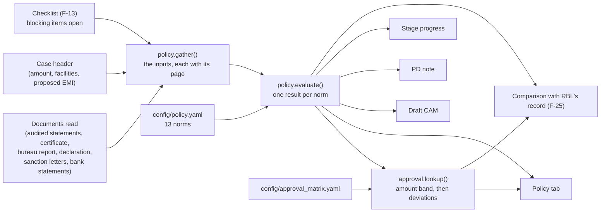

# Policy norms: how every norm works

| | |
|---|---|
| Feature | Stage 5 of the case workspace, the **Policy** tab (`/appraisals/$caseId/policy`): the norms, then the **Approving authority** panel |
| Requirements | FRD F-20 (policy norms and deviations), F-21 (approving authority); used by F-23 (draft CAM), F-24 (PD note) and F-25 (comparison with RBL's record) |
| Test plan rows | TC-24 Policy norms and deviations, TC-25 Approving authority (FRD TC-26, TC-27); criterion C4 |
| Code | [engine/policy.py](../engine/policy.py) (inputs and norms), [engine/approval.py](../engine/approval.py) (the authority), [engine/statements.py](../engine/statements.py) (lines read from the audited statements) |
| Configuration | [config/policy.yaml](../config/policy.yaml) (norms, ratios, deviation categories, PD questions), [config/approval_matrix.yaml](../config/approval_matrix.yaml) (the matrix), [config/statements.yaml](../config/statements.yaml) (statement lines), [config/tolerances.yaml](../config/tolerances.yaml) (instalment matching) |
| Related | [policy-authority-changes.md](policy-authority-changes.md) (the change register for this area) |
| Status | Every norm and the whole matrix are **provisional**, delivery-team proposals, until RBL supplies its own policy norms and approval matrix (FRD C.3). Development of this area is paused |
| As at | 12 October 2026 |

This document explains the logic end to end: where each figure a norm uses comes from, how each of the 13 norms decides its outcome, how the deviations decide who must approve the case, and where the results go. Code is quoted from the repository; `# ...` marks lines left out of a quotation. The worked examples are real engine output for the three test applications in the local store.

---

## Contents

1. [The idea in one page](#1-the-idea-in-one-page)
2. [When the norms are assessed](#2-when-the-norms-are-assessed)
3. [Norms are configuration](#3-norms-are-configuration)
4. [Where the figures come from](#4-where-the-figures-come-from)
5. [How a norm decides its outcome](#5-how-a-norm-decides-its-outcome)
6. [The norms one by one](#6-the-norms-one-by-one)
7. [Approving authority (F-21)](#7-approving-authority-f-21)
8. [Where the results go](#8-where-the-results-go)
9. [Worked examples](#9-worked-examples)
10. [Norm catalogue](#10-norm-catalogue)
11. [Known limits](#11-known-limits)
12. [Running the tests](#12-running-the-tests)

---

## 1. The idea in one page

A credit analyst checks a proposal against the bank's credit policy: is the business old enough, is its net worth positive, is the current ratio at least 1.2, is the request within 20% of turnover, are the documents in. The policy engine does the same for every case, and then works out who must approve it.

It works in three steps:

1. **Inputs** (`policy.gather`). The figures the norms need are collected from the case: the latest audited statements (revenue, profit, net worth, borrowings, current assets and liabilities), the certificate of incorporation (years in business), the commercial bureau report (rank), the existing facilities and bank statements (annual instalments), the case header (amount requested, proposed instalment) and the checklist (blocking items open). Every figure keeps the page it came from.
2. **Norms** (`policy.evaluate`). Each norm in [config/policy.yaml](../config/policy.yaml) is an arithmetic expression over those inputs and a threshold. It gives one outcome: **pass**, **deviation**, **cannot evaluate** (naming what is missing or why) or **not applicable**.
3. **Approving authority** (`approval.lookup`). The amount requested picks an authority from the matrix for each product; each category of deviation raises it by its rule; the case needs the highest.



The 13 norms fall in four families, each a deviation category for the approving authority:

| Family | Norms | Deviation category |
|---|---|---|
| Eligibility | EL-01 to EL-05 | Eligibility |
| Financial ratios | FR-01 to FR-06 | Financial norms |
| Documentation | DOC-01, DOC-02 | Documentation |
| Security cover | none yet (needs valuation reports) | Security cover |

---

## 2. When the norms are assessed

Unlike the cross-checks, the policy assessment is **not stored**: it is computed from the case's current state each time something asks for it. The entry point is `assess` in [engine/policy.py](../engine/policy.py):

```python
def assess(conn: sqlite3.Connection, root: Path, case: CaseDetail) -> PolicyAssessment:
    policy = reader.load_policy(root)
    ratios = {r.key: r for r in policy.ratios}
    categories = {c.key: c.label for c in policy.deviation_categories}
    inputs = gather(conn, root, case)
    wc_limit = policy.working_capital.mpbf_above_limit_inr
    return PolicyAssessment(
        case_id=case.id,
        period=inputs.period,
        norms=[evaluate(n, ratios.get(n.ratio or ""), case, inputs, categories, wc_limit) for n in policy.norms],
        config_version=reader.published_version(root)["version"],
    )
```

It is called by `GET /api/cases/{id}/policy` (the Policy tab), `GET /api/cases/{id}/approving-authority`, the stage progress, the draft CAM, the PD note and the comparison. So a document read, a value confirmed or corrected, or a newly published configuration shows at once. The assessment records the configuration version it used.

---

## 3. Norms are configuration

Every norm is a YAML entry (F-20.1). Nothing about a norm's formula, threshold, applicability or category is in the code. Two examples, a plain norm and a ratio norm:

```yaml
  - id: EL-05
    family: eligibility
    label: Total request against turnover
    expression: amount_requested / revenue_from_operations * 100
    unit: "%"
    kind: max
    threshold: 20
    category: eligibility
    applies_when: turnover_method
    source: provisional
    status: provisional

  - id: FR-01
    family: ratios
    ratio: current-ratio
    expression: current_assets / current_liabilities
    category: financial
    applies_when: working_capital
```

A ratio norm takes its label, unit, direction and threshold from the `ratios` list:

```yaml
ratios:
  - key: current-ratio
    label: Current ratio
    unit: x
    kind: min
    acceptable: 1.2
    marginal: 1.1
    formula: "Current assets ÷ Current liabilities"
    source: provisional
    status: provisional
```

| Field | Meaning |
|---|---|
| `id`, `family`, `label` | How the norm is named; the family picks its PD question |
| `expression` | Arithmetic (`+ - * /`, brackets, numbers) over the inputs in section 4. Anything else is rejected when publishing, and if it ever reached the engine the norm would be "cannot evaluate", never a crash |
| `unit` | `x`, `%`, `days`, `years`, `inr`, `count` or `rank`: how the values are written |
| `kind`, `threshold` | `min` (at least) or `max` (at most), and the threshold. Thresholds are inclusive |
| `ratio` | For a ratio norm: the ratio whose label, unit, direction and `acceptable` threshold it uses (`marginal` is recorded but not used yet) |
| `category` | The deviation category a breach falls under (eligibility, financial, security, documentation): the approving authority's input |
| `applies_when` | `always`, `working_capital` (a working-capital facility is requested), `turnover_method` (working capital at or below `working_capital.mpbf_above_limit_inr`, INR 5 cr), `term_debt` (a term loan, or instalments on existing facilities), `collateral` |
| `constitutions` | When set, the norm does not apply to a case of another known constitution |
| `non_positive_denominator` | `cannot_evaluate` (default) or `deviation`: what a zero or negative divisor means. Leverage over a non-positive net worth is a deviation, never a pass |
| `pd_gap` | `skip`: when the norm cannot be evaluated, the promoter is not asked (the bank obtains the input itself, as for the bureau report) |
| `source`, `status`, `note` | Provenance (`provisional`, `regulatory`, `rbl_supplied`, …), and a note shown with the norm |
| `pd_question` | Overrides the family's question for the personal discussion |

The expression is parsed with Python's `ast` module and only arithmetic nodes are allowed:

```python
# The only expression nodes a norm may use (F-20.1): arithmetic over inputs and numbers.
ALLOWED_NODES = (ast.Expression, ast.BinOp, ast.UnaryOp, ast.Add, ast.Sub, ast.Mult, ast.Div, ast.USub,
                 # ...
```

---

## 4. Where the figures come from

`policy.gather` builds every input once per assessment. Each input is a `NormInput`: its value, its evidence pages, whether it relies on a person's entry, whether it is still **waiting for review**, and, when it has no document page, where it comes from (`basis`: the case header, the checklist, statement coverage, or "no term loan requested").

| Input | Where it comes from |
|---|---|
| `revenue_from_operations`, `other_income`, `depreciation`, `finance_costs`, `profit_before_tax`, `profit_after_tax`, `share_capital`, `reserves_and_surplus`, `long_term_borrowings`, `short_term_borrowings`, `inventories`, `trade_receivables`, `trade_payables` | The **latest audited statements** (the one with the latest period end), each line found by its row label ([config/statements.yaml](../config/statements.yaml) `lines`). If there are two copies of the latest year, each figure comes from the first copy that has it |
| `ebitda`, `net_worth`, `total_borrowings`, `current_assets`, `current_liabilities` | Derived from those lines (`derived`): net worth = share capital + reserves and surplus; total borrowings = long-term + short-term; current assets = inventories + trade receivables + cash and bank + short-term loans and advances; current liabilities = short-term borrowings + trade payables + other current liabilities + short-term provisions; EBITDA = profit before tax + finance costs + depreciation. A derived line exists only when every part is printed |
| `audited_years` | How many distinct financial years of audited statements are on file |
| `amount_requested` | The case's total amount, citing the sourcing message where the RM's message gave it |
| `vintage_years` | Completed months from the date of incorporation (certificate of incorporation) to the case's as-of date, divided by 12. Never rounded up: a month counts only once its day is reached |
| `bureau_rank` | The credit rank on the latest commercial bureau report (by report date; the last filed if undated or tied). A report without a numeric rank gives no input |
| `annual_instalments` | Twelve times the monthly instalments on existing facilities: declared, then sanctioned, then inferred from the bank statements, each facility counted once (below). Zero when enough months of statements show no instalment |
| `proposed_instalments` | Twelve times the proposed monthly instalment on the term loan the RM entered; zero when no term loan is requested |
| `blocking_items_open` | The checklist's open blocking items (F-13), with their ids |
| `market_value`, `realisable_value` | Reserved for security-cover norms; no document type supplies them yet |

**Instalments counted once.** The debt-service norm must not count one loan twice when it appears in the declaration, a sanction letter and the bank statements:

```python
    # Annual instalments on existing facilities: declared, then sanctioned, then inferred from the
    # bank statements, each facility counted once.
    emi_pct = tolerances.get("emi_amount_match", 5)
    declared, sanctioned = _counted_facilities(facts.facilities, noise, threshold, emi_pct)
    inferred = [o for o in facts.obligations
                if not any(_pays(o, f, noise, threshold, emi_pct) for f in declared + sanctioned)]
    if declared or sanctioned or inferred:
        monthly = sum(f.emi or 0 for f in declared + sanctioned) + sum(o.typical_amount for o in inferred)
        inputs.put("annual_instalments", monthly * 12, ...)
    elif sum(1 for m in facts.months if m.bank is not None) >= int(tolerances.get("emi_min_occurrences", 3)):
        # Enough months of statements and no instalment in them: none on existing facilities.
        inputs.put("annual_instalments", 0, ..., basis="statements_coverage")
```

- A lender matches on its resolved name only: "Indian Bank" and "Indian Overseas Bank" are two lenders.
- A second document restating a facility already counted from the same source (a re-signed declaration, a renewed sanction letter: same lender, facility and instalment) is not counted again; two loans in one letter are two loans.
- A sanction letter from a lender the declaration already lists with an instalment is that declared facility.
- A recurring bank debit pays a declared or sanctioned facility when it names the same lender, or when its narration abbreviates the lender ("TIDEWATER FIN") and the amount is the facility's instalment (within `emi_amount_match`, 5%). Only debits that pay no known facility are added as inferred instalments.

**The period.** The financial inputs' year (`period`, for example "FY 2025-26") is shown with the assessment and used in the PD questions.

---

## 5. How a norm decides its outcome

`policy.evaluate` takes one norm and returns a `NormResult`: the norm, the required value ("at least 1.20x"), the actual value, the inputs with their pages, the outcome, and the deviation category. The checks run in a fixed order, and the first that applies decides:

| Step | Situation | Outcome |
|---|---|---|
| 1 | The norm does not apply to this case (`applies_when`, `constitutions`) | **Not applicable** |
| 2 | The expression uses anything but arithmetic | **Cannot evaluate** ("a supported expression") |
| 3 | An input the expression needs is not on file | **Cannot evaluate**, naming every missing input (F-20.3) |
| 4 | An input is still waiting for a person's review | **Cannot evaluate**, reason "awaiting review", naming the figures (F-17.2) |
| 5 | A divisor is zero or negative | **Cannot evaluate** ("zero denominator" / "denominator not positive"), or **Deviation** with an unbounded value when the norm says `non_positive_denominator: deviation` |
| 6 | Otherwise | **Pass** if the value meets the threshold (inclusive), else **Deviation** |

A norm is never a pass on a guess: a missing or unconfirmed figure, or a divisor that makes the ratio meaningless, never passes.

```python
    if not _applies(norm, case, inputs, wc_limit):
        return result
    tree = ast.parse(norm.expression, mode="eval")
    # ...
    missing: list[str] = []
    divisors: list[tuple[str, float]] = []
    actual = evaluate_expression(tree, {k: v.value for k, v in inputs.values.items() if v.value is not None},
                                 missing, divisors)
    # ...
    if missing:
        result.outcome = "cannot_evaluate"
        result.missing = list(dict.fromkeys(missing))
        return result
    waiting = [i.label for i in result.inputs if i.awaiting_review]
    if waiting:
        # F-17.2: a figure below its confidence threshold is reviewed before a norm relies on it.
        result.outcome, result.reason, result.reason_inputs = "cannot_evaluate", "awaiting_review", waiting
        return result
    bad = [(text, value) for text, value in divisors if value <= 0]
    if bad:
        labels = list(dict.fromkeys(text for text, _ in bad))
        result.reason_inputs = labels
        if norm.non_positive_denominator == "deviation":
            result.outcome, result.reason = "deviation", "denominator_not_positive"
            result.actual_text = f"unbounded ({', '.join(labels)} zero or negative)"
        else:
            result.outcome = "cannot_evaluate"
            result.reason = "zero_denominator" if all(value == 0 for _, value in bad) else "denominator_not_positive"
        return result
    result.actual = round(actual, 4)
    # Inclusive, and compared at 9 decimals so a value equal to the threshold is never lost to floating point.
    value = round(actual, 9)
    ok = value >= threshold if kind == "min" else value <= threshold
    result.outcome = "pass" if ok else "deviation"
```

**Applicability:**

```python
def _applies(norm: PolicyNorm, case: CaseDetail, inputs: Inputs, wc_limit: float) -> bool:
    if norm.constitutions and case.constitution in KNOWN_CONSTITUTIONS and case.constitution not in norm.constitutions:
        return False
    if norm.applies_when == "working_capital":
        return bool(set(case.facilities) & WORKING_CAPITAL)
    if norm.applies_when == "turnover_method":
        return bool(set(case.facilities) & WORKING_CAPITAL) and case.amount_inr <= wc_limit
    if norm.applies_when == "term_debt":
        instalments = inputs.values.get("annual_instalments")
        return bool(set(case.facilities) & TERM) or bool(instalments and instalments.value)
    if norm.applies_when == "collateral":
        return bool(case.collateral_present)
    return True
```

Working-capital facilities are cash credit, overdraft, WCDL, packing credit and post-shipment credit; the term facility is the term loan.

**How values are written.** Ratios to two decimals (1.59x), percentages to one (60.5%), days whole (90 days), amounts in INR crore or lakh (INR 4.20 cr), negative amounts with their sign (INR -4.00 cr). Years are truncated, never rounded up to a threshold: 2.99 years reads "2.9 years". A deviation never reads the same as its norm: decimals are added while the two would round to the same number (20.04% against "at most 20%", never "20.0%"):

```python
def actual_text(value: float, unit: str | None, threshold: float, outcome: str) -> str:
    """The actual as written; a deviation never reads the same as its norm (20.04% against at
    most 20%, never 20.0%): decimals are added while the two still round to the same number."""
```

---

## 6. The norms one by one

All thresholds are provisional proposals until RBL's norms replace them.

### 6.1 Eligibility

| Norm | Expression | Required | Applies | Notes |
|---|---|---|---|---|
| **EL-01** Business vintage | `vintage_years` | at least 3 years | Private limited companies | Completed months since incorporation, to the case's as-of date. Partnerships and proprietorships have no registration-date document in scope yet, so the norm does not apply to them |
| **EL-02** Commercial bureau rank | `bureau_rank` | at most rank 6 | Always | Rank 1 is the lowest risk. From the latest bureau report. The bank obtains the report, so a missing one is not asked of the promoter (`pd_gap: skip`), but the norm still cannot be evaluated |
| **EL-03** Positive net worth | `net_worth` | at least INR 1 | Always | Share capital plus reserves and surplus |
| **EL-04** Profit in the latest year | `profit_after_tax` | at least INR 0 | Always | A loss is a deviation |
| **EL-05** Total request against turnover | `amount_requested / revenue_from_operations * 100` | at most 20% | Working capital up to INR 5 cr (turnover method) | The bank finances up to 20% of annual turnover. The whole amount requested is used, including any term loan, until per-facility amounts are captured. Above INR 5 cr the MPBF method applies and this norm is not applicable |

### 6.2 Financial ratios

| Norm | Expression | Required | Applies | Notes |
|---|---|---|---|---|
| **FR-01** Current ratio | `current_assets / current_liabilities` | at least 1.20x | Working capital requested | |
| **FR-02** TOL / TNW | `(long_term_borrowings + current_liabilities) / net_worth` | at most 3.00x | Always | A net worth of zero or less is a deviation ("unbounded"), never a pass. Net worth is not reduced by intangibles, and only long-term borrowings count among non-current liabilities, until RBL defines tangible net worth |
| **FR-03** DSCR | `(profit_after_tax + depreciation) / (annual_instalments + proposed_instalments)` | at least 1.50x | A term loan requested, or instalments on existing facilities | Interim and conservative: instalments (interest and principal) on existing facilities and the proposed term loan; interest on term debt is not added back. With a term loan requested and no proposed instalment entered, it cannot be evaluated |
| **FR-04** Interest coverage | `(profit_before_tax + finance_costs) / finance_costs` | at least 2.50x | Always | EBIT over finance costs. No finance costs: cannot evaluate (zero denominator) |
| **FR-05** Debt / equity | `total_borrowings / net_worth` | at most 2.00x | Always | Non-positive net worth: deviation, as FR-02 |
| **FR-06** Working-capital cycle | `(inventories + trade_receivables - trade_payables) / revenue_from_operations * 365` | at most 75 days | Working capital requested | Days on sales; RBL may use cost of sales for inventory and payables |

The ratios list also defines buyer concentration (at most 35%), which no norm uses yet: no document type gives customer-wise sales.

### 6.3 Documentation

| Norm | Expression | Required | Applies | Notes |
|---|---|---|---|---|
| **DOC-01** Blocking checklist items open | `blocking_items_open` | at most 0 | Always | The open blocking items are listed with a link to the Completeness tab |
| **DOC-02** Years of audited financial statements | `audited_years` | at least 2 years | Always | Distinct financial years of audited statements on file |

### 6.4 Security cover

No security-cover norm is configured: collateral values need valuation-report and stock-statement document types, which are not in scope. The Policy tab says so, and a test pins that state.

---

## 7. Approving authority (F-21)

Who must approve the case, from the published matrix ([config/approval_matrix.yaml](../config/approval_matrix.yaml)) and the policy assessment. The matrix is a provisional proposal (decision C.4-9); while it is, the panel says "Provisional matrix" and TC-25 is reported as not scored.

| Part of the matrix | Provisional content |
|---|---|
| Authorities, lowest first | Credit Officer (1), Regional Credit Head (2), Zonal Credit Committee (3), Head Office Credit Committee (4), Management Credit Committee (5) |
| Products | Working capital (cash credit, overdraft, WCDL, packing credit, post-shipment), Term loan, Non-fund based (bank guarantee, letter of credit) |
| Amount bands (inclusive) | Working capital: up to INR 2 cr Credit Officer, 5 cr Regional Credit Head, 15 cr Zonal, 50 cr Head Office, above Management. Term loan: 1 cr, 3 cr, 10 cr, 35 cr. Non-fund: 3 cr, 7.5 cr, 20 cr, 60 cr |
| Deviation rules | Eligibility: one level above, at least Regional Credit Head. Financial norms: one level above. Security cover: one level above, at least Zonal Credit Committee. Documentation: one level above |

**How it is worked out** (`approval.lookup`):

1. For each product requested, the **amount band** the case's amount falls in gives an authority. The amount is the case's total amount requested (`amount_basis: amount_requested`).
2. The **base** is the highest of those.
3. For each deviation category with a deviation, the rule raises the base by `levels_above`, to at least `at_least`, capped at the top authority.
4. Rules **never add up**: each counts from the base, and the case needs the highest authority any one step needs. That step is marked as deciding.

```python
    base = max(ladder.index(by_key[s.authority.key]) for s in steps)

    rules = {r.category: r for r in matrix.deviations}
    for category in category_order:
        found = deviations.get(category)
        rule = rules.get(category)
        if not found or rule is None:  # the publish cross-check gives every category a rule
            continue
        position = base + rule.levels_above
        at_least = by_key[rule.at_least] if rule.at_least else None
        if at_least is not None:
            position = max(position, ladder.index(at_least))
        capped = position > len(ladder) - 1
        authority = ladder[min(position, len(ladder) - 1)]
        # ...
    top = max(s.authority.level for s in steps)
    governing = next(s for s in steps if s.authority.level == top)
    governing.governs = True
```

**Norms that could not be assessed.** If any norm is "cannot evaluate", the answer is a **lower bound**: the panel also says what the authority could rise to if those norms turned out to be deviations (the lookup is repeated with them counted as deviations in their categories).

**No product.** A case whose facilities belong to no product in the matrix gives "cannot determine".

The authority reads configuration only. It never reads RBL's reference record (an import-linter contract): the analyst works blind to the recorded approval.

---

## 8. Where the results go

| Where | What it shows |
|---|---|
| **Policy tab** | An overview at the top: one card per family of norms (its deviations large, the norms that could not be evaluated, passed or did not apply, and up to three key norms with actual against required), and an **Approving authority** card (the authority, its level, "at least" when norms could not be assessed, the amount authority and the deviation steps). Below it, one section per family and then the authority's steps. The engine supplies the overview (`PolicyAssessment.counts`, `.groups`); the screen counts nothing. Each norm shows: a notice that the norms are interim; its required and actual values, its outcome, its deviation category, the figures it used with their pages (or where a figure without a page comes from), the formula evaluated, the ratio's definition and its note; why a norm could not be assessed (missing figures, a zero divisor, a figure waiting for review); the line that no security-cover norm can be evaluated yet; the **Approving authority** panel (the authority, its level, the amount and products, each rule applied with the deciding one marked, and whether unassessed norms could raise it) |
| **Stage progress** | The Policy stage needs attention while a norm cannot be evaluated; deviations are listed, not blocking |
| **Draft CAM** | The policy section counts the norms that passed, deviated or could not be assessed, says the norms are interim, and writes one sentence per deviation with its figures cited; the summary lists the deviations and the norms not assessed |
| **PD note** | A question per deviation (the norm's own, else its family's, from `pd_questions`), and per norm that could not be evaluated (by its reason), except figures waiting for review (an internal step) and norms marked `pd_gap: skip` |
| **Comparison (F-25)** | RBL's recorded deviations and approving authority beside CreditIQ's, each item marked Agree, Differ, New or Missed (Credit Manager only) |

The PD questions, from [config/policy.yaml](../config/policy.yaml):

```yaml
pd_questions:
  eligibility: "{label} is {actual} against a norm of {required}. What is the background, and what mitigates it?"
  ratios: "{label} is {actual} in {period} against a norm of {required}. What explains it, and how is it expected to move?"
  documentation: "{label}: {actual} against a norm of {required}. When will the documents be available?"
  cannot_evaluate: "{label} could not be assessed: {missing} not on file. Can the promoter provide it?"
  zero_denominator: "{label} could not be computed because {inputs} is zero. What explains it?"
```

---

## 9. Worked examples

Real engine output for the three test applications in the local store (12 October 2026, after Kestrel's and Heronbay's FY 2025-26 income tax returns were filed, which left each with one blocking checklist item fewer). The financial inputs come from their FY 2025-26 audited statements.

### Kestrel Fabricators (TEST), BBG-2026-000004

Cash credit and term loan, INR 6.50 cr. Above INR 5 cr, so the turnover method (EL-05) does not apply.

| Norm | Outcome | Required | Actual | Figures |
|---|---|---|---|---|
| EL-01 Business vintage | Pass | at least 3 years | 11.2 years | Certificate of incorporation |
| EL-02 Bureau rank | Pass | at most rank 6 | rank 5 | Bureau report |
| EL-03 Net worth | Pass | at least INR 1 | INR 4.20 cr | Share capital + reserves |
| EL-04 Profit | Pass | at least INR 0 | INR 64.00 lakh | |
| EL-05 Request against turnover | Not applicable | at most 20% | | Above the turnover-method limit |
| FR-01 Current ratio | Pass | at least 1.20x | 1.59x | 5.90 cr ÷ 3.70 cr |
| FR-02 TOL / TNW | Pass | at most 3.00x | 1.24x | (1.50 cr + 3.70 cr) ÷ 4.20 cr |
| FR-03 DSCR | **Cannot evaluate** | at least 1.50x | | Term loan requested, but no proposed instalment entered |
| FR-04 Interest coverage | Pass | at least 2.50x | 3.14x | (75.00 lakh + 35.00 lakh) ÷ 35.00 lakh |
| FR-05 Debt / equity | Pass | at most 2.00x | 0.64x | 2.70 cr ÷ 4.20 cr |
| FR-06 Working-capital cycle | **Deviation** | at most 75 days | 90 days | (2.50 cr + 2.40 cr − 2.00 cr) ÷ 11.80 cr × 365 |
| DOC-01 Blocking items open | **Deviation** | at most 0 | 3 | The checklist |
| DOC-02 Years of audited statements | Pass | at least 2 years | 2 years | |

**Approving authority: Head Office Credit Committee (level 4), a lower bound.**
- Amount: INR 6.50 cr is in the 5–15 cr working-capital band and the 3–10 cr term band, both Zonal Credit Committee (3).
- Financial deviation (FR-06): one level above, Head Office Credit Committee (4), the deciding rule.
- Documentation deviation (DOC-01): also Head Office Credit Committee.
- FR-03 could not be assessed; if it were a deviation it is also financial, so the authority could rise no higher.

### Marigold Agro Foods (TEST), BBG-2026-000006

Cash credit, INR 3.00 cr: the turnover method applies.

| Norm | Outcome | Actual | Why |
|---|---|---|---|
| EL-02 Bureau rank | **Cannot evaluate** | | No bureau report on file (the promoter is not asked: the bank obtains it) |
| EL-05 Request against turnover | **Deviation** | 60.5% | INR 3.00 cr ÷ INR 4.96 cr revenue, against at most 20% |
| FR-03 DSCR | Pass | 2.51x | (26.88 lakh + 16.80 lakh) ÷ (17.40 lakh + 0): no term loan requested |
| FR-06 Working-capital cycle | **Deviation** | 90 days | |
| DOC-01 Blocking items open | **Deviation** | 7 | |
| DOC-02 Years of audited statements | **Deviation** | 1 year | Only FY 2025-26 on file |
| The other seven | Pass | | |

**Approving authority: Zonal Credit Committee (level 3), a lower bound.** The amount band (2–5 cr working capital) gives Regional Credit Head (2); the eligibility, financial and documentation deviations each raise it one level, to Zonal Credit Committee. EL-02 could not be assessed; it is eligibility, already deviating, so the authority could rise no higher.

### Heronbay Polymers (TEST), BBG-2026-000005

The same financial statements as Kestrel, so the same ratios: FR-06 is a deviation (90 days), FR-03 cannot be evaluated (no proposed instalment), and DOC-01 is a deviation (2 blocking items). Bureau rank 3, 14.5 years in business. Authority: Head Office Credit Committee, a lower bound. A clean cross-verification file can still deviate from policy: the two are independent.

---

## 10. Norm catalogue

| ID | Family | Norm | Expression | Unit | Direction | Threshold | Applies | Category |
|---|---|---|---|---|---|---|---|---|
| EL-01 | Eligibility | Business vintage | `vintage_years` | years | min | 3 | Private limited | Eligibility |
| EL-02 | Eligibility | Commercial bureau rank | `bureau_rank` | rank | max | 6 | Always | Eligibility |
| EL-03 | Eligibility | Positive net worth | `net_worth` | INR | min | 1 | Always | Eligibility |
| EL-04 | Eligibility | Profit in the latest year | `profit_after_tax` | INR | min | 0 | Always | Eligibility |
| EL-05 | Eligibility | Total request against turnover | `amount_requested / revenue_from_operations * 100` | % | max | 20 | Turnover method | Eligibility |
| FR-01 | Ratios | Current ratio | `current_assets / current_liabilities` | x | min | 1.2 | Working capital | Financial |
| FR-02 | Ratios | TOL / TNW | `(long_term_borrowings + current_liabilities) / net_worth` | x | max | 3.0 | Always | Financial |
| FR-03 | Ratios | DSCR | `(profit_after_tax + depreciation) / (annual_instalments + proposed_instalments)` | x | min | 1.5 | Term debt | Financial |
| FR-04 | Ratios | Interest coverage | `(profit_before_tax + finance_costs) / finance_costs` | x | min | 2.5 | Always | Financial |
| FR-05 | Ratios | Debt / equity | `total_borrowings / net_worth` | x | max | 2.0 | Always | Financial |
| FR-06 | Ratios | Working-capital cycle | `(inventories + trade_receivables - trade_payables) / revenue_from_operations * 365` | days | max | 75 | Working capital | Financial |
| DOC-01 | Documentation | Blocking checklist items open | `blocking_items_open` | count | max | 0 | Always | Documentation |
| DOC-02 | Documentation | Years of audited financial statements | `audited_years` | years | min | 2 | Always | Documentation |

Every norm's source and status are provisional.

---

## 11. Known limits

- **Provisional norms and matrix.** Every threshold and the whole approval matrix are delivery-team proposals. RBL's norms and matrix are published from a git-ignored directory (`creditiq config publish --private-config DIR`) when supplied, then every case is assessed again.
- **Security cover.** No norm until valuation-report and stock-statement document types exist.
- **Tangible net worth.** Net worth is share capital plus reserves; intangibles and deferred tax are not deducted, and FR-02 counts only long-term borrowings among non-current liabilities, until RBL defines TNW.
- **DSCR.** A conservative interim definition: interest on term debt is not added back, and a requested term loan without a proposed instalment leaves FR-03 unassessed.
- **One amount for every product.** EL-05 and the matrix use the case's total amount, including any term loan, until per-facility amounts are captured.
- **Vintage for firms.** EL-01 applies to companies only; partnerships and proprietorships need a registration-date source (Udyam or GST registration).
- **Working-capital cycle on sales.** FR-06 uses revenue for every component; RBL may use cost of sales for inventory and payables.
- **MPBF.** Requests above INR 5 cr have no MPBF norm yet; EL-05 applies under the turnover method only.
- **Marginal thresholds.** Each ratio records a marginal value, not used yet.
- **Copies that disagree.** Two copies of the latest year's statements that disagree are not flagged; each figure comes from the first copy that has it.

---

## 12. Running the tests

Engine tests (from the repository root, Windows):

```powershell
.venv\Scripts\python.exe -m pytest -q tests/test_policy.py tests/test_approval.py tests/test_comparison.py tests/test_reference.py
```

`tests/test_policy.py` (42 tests) covers each norm's sources, applicability, missing inputs, figures waiting for review, zero and negative divisors, inclusive thresholds, the deviation wording, instalments counted once, and the TC-26 record. `tests/test_approval.py` (19 tests) covers the bands, the deviation rules, the lower bound and the provisional marking.

Screen tests for the Policy tab and the approving authority (on a machine where port 5173 is taken, use the local alternate-port configuration):

```powershell
npx playwright test e2e/tc26-tc27-policy-authority.spec.ts
```

The assessment for any case can be inspected with `GET /api/cases/{id}/policy`, and the authority with `GET /api/cases/{id}/approving-authority`.
